[日本語](README-LOG.md) | **English**

# NagiLog (personal log)

[](#demo)
[](README.en.md)
[](https://github.com/Lichiphen/NagiSwipe/releases/latest)
[](https://github.com/Lichiphen/NagiSwipe)
[](https://gitlab.com/lichiphen/nagiswipe)
[](https://nagiswipe.pages.dev/nagilog.en.html)
[](#installation-and-login)
[](../LICENSE)

A log for posting text, pictures, manga, video and audio to your own site, casually. It is one of NagiSeries ([NagiSwipe](../README.en.md#nagiswipe), [NagiManga](README.en.md) and NagiLog).
It uses no database and shares NagiManga's manga management and login.
The posting screen on phones follows the layout and the division of controls of NagiMemo.

NagiLog has been in the NagiManga release ZIP since NagiManga v0.4.0.

[](https://lichiphen.com/tool/link/r/NagiManga)
[](https://nagiswipe.pages.dev/nagilog.en.html)

The admin panel can be shown in Japanese or English ([Admin panel language](README.en.md#admin-panel-language)). The public pages are shown in Japanese, or in English when the admin language is set to English. Names of screens and buttons below are the English ones, sometimes with the Japanese name of the Japanese panel in quotes.

<!-- TOC -->
## Contents

- [Demo](#demo)
- [Summary of the specification](#summary-of-the-specification)
- [Screens](#screens)
- [What it does](#what-it-does)
- [Strengths](#strengths)
- [Weaknesses and the scale it suits](#weaknesses-and-the-scale-it-suits)
- [Installation and login](#installation-and-login)
- [Settings and audience](#settings-and-audience)
- [Keep using it locally](#keep-using-it-locally)
- [Public URLs](#public-urls)
- [Posts, pictures and manga](#posts-pictures-and-manga)
  - [Headings](#headings)
  - [Table of contents](#table-of-contents)
  - [Markdown in posts](#markdown-in-posts)
  - [Ruby (reading aids)](#ruby-reading-aids)
  - [Alerts and diagrams (Mermaid)](#alerts-and-diagrams-mermaid)
- [Content warnings (sensitive, R-18, R-18G)](#content-warnings-sensitive-r-18-r-18g)
- [Embedding social media and video](#embedding-social-media-and-video)
  - [Blog cards](#blog-cards)
  - [Page embeds](#page-embeds)
- [Picture formats, sizes and management](#picture-formats-sizes-and-management)
  - [SVG](#svg)
- [Video and audio](#video-and-audio)
- [Deleting posts and their own pictures](#deleting-posts-and-their-own-pictures)
- [Categories and hashtags](#categories-and-hashtags)
- [Design and cache](#design-and-cache)
  - [Footer links](#footer-links)
  - [LiteSpeed Cache](#litespeed-cache)
  - [Making uncached views fast too](#making-uncached-views-fast-too)
  - [Loading indicators](#loading-indicators)
- [Additional CSS](#additional-css)
  - [The syntax check](#the-syntax-check)
  - [How it applies](#how-it-applies)
  - [Storage and updates](#storage-and-updates)
  - [Classes and elements for customizing](#classes-and-elements-for-customizing)
- [Search](#search)
- [List styles and related posts](#list-styles-and-related-posts)
- [Pinned posts](#pinned-posts)
- [Password locks](#password-locks)
- [Likes](#likes)
- [Reordering the sidebar and HTML boxes](#reordering-the-sidebar-and-html-boxes)
- [Title logo and introduction](#title-logo-and-introduction)
- [Favicon and home screen icons](#favicon-and-home-screen-icons)
- [Top menu](#top-menu)
- [Fixed pages](#fixed-pages)
  - [Top page and blog](#top-page-and-blog)
- [SEO and OGP](#seo-and-ogp)
  - [Breadcrumbs](#breadcrumbs)
  - [Keeping it out of search engines](#keeping-it-out-of-search-engines)
  - [Sitemap](#sitemap)
  - [RSS](#rss)
  - [Descriptions](#descriptions)
- [Measures against image-scraping bots](#measures-against-image-scraping-bots)
- [Protecting the storage](#protecting-the-storage)
- [Storage layout and backup](#storage-layout-and-backup)
- [Tests and what remains to be checked](#tests-and-what-remains-to-be-checked)
- [Sources and writing](#sources-and-writing)
<!-- /TOC -->

## Demo

**https://notebook.lichiphen.com/nagimanga/**

The log the author actually uses. You can try the public pages, the phone menu, the mail dialog and the 404 page.
The posting and settings screens are for the author only. How things look when logged in is shown under "Screens" below.
It is the same installation as the manga viewer demo ([demo.html](https://notebook.lichiphen.com/nagimanga/demo.html)). One installation runs both the manga management and the log.

## Summary of the specification

| Item | Details |
| --- | --- |
| Version | 0.9.0 (included in NagiManga v0.9.0) |
| Requirements | PHP 8.1 or later (GD, fileinfo, mbstring). Backups and EPUB also use ZipArchive; HTML boxes and SVG also use the DOM extension. HTTPS and a server where `.htaccess` works (Apache, LiteSpeed) are recommended |
| Storage | No database. Each post is stored as its own file; storage and login are shared with NagiManga |
| Audience | Public to everyone, or a private Memo (readable only when you are logged in) |
| Posts | The first line of the text is the title. Markdown (bold, italic, headings, lists, quotes, tables and more), URLs, hashtags, manga cards and embeds can be used. Posts with four or more headings get a table of contents. Drafts, editing and automatic keeping of unfinished text. Works on phones too |
| Placing media | Pictures, video and audio go at the cursor in the text, on a line such as 〔メディア1〕, and the band in the text can be dragged to move them. They can also be added by dropping or pasting |
| Pictures | JPEG, PNG, GIF, WebP, AVIF and BMP are accepted, read again and saved as WebP or JPEG (pictures over 4096px are reduced; GIF animations stay GIF). The limit can be set from 1 to 200MB, 30MB by default. SVG can be imported after its contents are checked (up to 2MB). Pictures in a row become a gallery and zoom with NagiSwipe |
| Video and audio | Video: MP4, MOV, WebM. Audio: MP3, M4A, OGG, WAV, FLAC (up to 1GB per file, sent in pieces). Audio has a waveform player with gapless repeat, and reads and writes covers and loop points (`LOOPSTART`). Videos play as chosen: normal, like a GIF, autoplay or repeat |
| Content warnings | Posts and media can be marked sensitive, R-18 or R-18G. Shown blurred, folded and with an age check; share cards are blurred automatically |
| Embeds | Paste a URL on a line of its own to embed 22 services such as YouTube, X, Instagram, Spotify, SoundCloud, Bluesky and TikTok, manga sites (19 GigaViewer sites such as Shonen Jump+) and video files. Other pages are shown as blog cards made from their OGP |
| URLs | Posts live at `./20261004123033` and fixed pages at `./privacy`, without `?` (on servers that apply `.htaccess`). The old `./?id=…` and `./?pg=…` redirect to them with 301 |
| Lists and display | Microblog and tiles, 3 kinds of paging, pinned posts (several, reorderable), a new mark, related posts, likes, sharing, search, a calendar. Six designs (3 light, 3 dark), all meeting the WCAG 2.2 AA color contrast |
| Building the site | Fixed pages (Markdown), a fixed page as the top with the posts at `./blog` (on or off), a top menu, footer links, a title logo, a favicon and home screen icons (every size made from one picture), a reorderable sidebar with HTML boxes, profile and links, a black hole 404 |
| Admin panel | Post list (search, bulk delete), media list (search, replace), renaming and reordering categories and hashtags. Shown in Japanese or English. With English chosen, the public pages are in English too |
| Search engines and sharing | canonical, OGP, breadcrumbs (JSON-LD), sitemap, RSS (all, per category, per tag), a setting that keeps every page out of search |
| Speed | Works with LiteSpeed Cache. Versioned JS and CSS are kept by browsers for a year. Posts off screen are built later, and video and audio are served a little at a time |
| Safety | Password, IP restriction, limited login attempts, CSP, redrawing pictures, checking SVG, measures against image-scraping bots. Logins last 30 days (1 year in the settings) |
| Backup | A log ZIP saves and restores posts, media and settings. Restoring converts the pictures a little at a time and shows the progress |
| Scale | For small sites used by one person |

## Screens

The posting box, settings, media list and fixed page examples were captured locally on October 7, 2026. The texts and choices are examples. The screens are those of the Japanese panel.

**Computer**: posts on the left, the profile and links on the right. Each post shows its date above it.

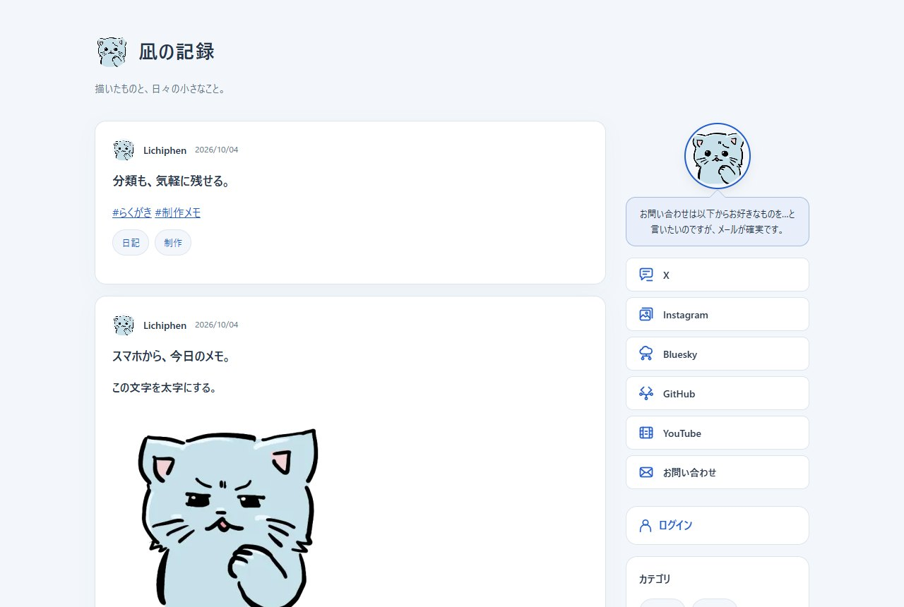

**Phone**: posts take the full width. "MENU" at the top right opens the same sidebar as on computers.
The mail button lets the visitor copy the address or send with their usual mail app.

<table>
<tr>
<td align="center">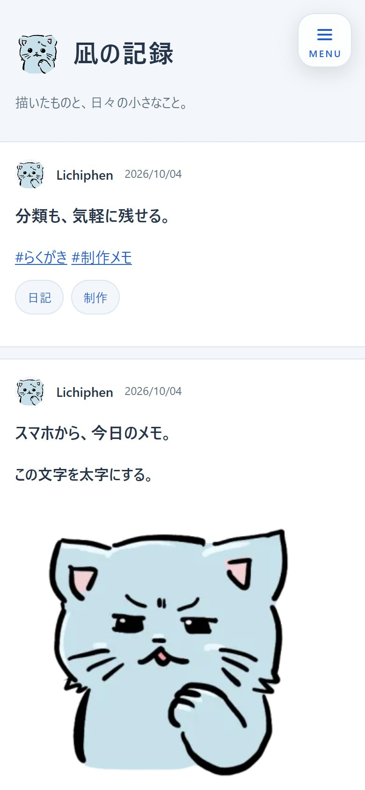<br>Top</td>
<td align="center">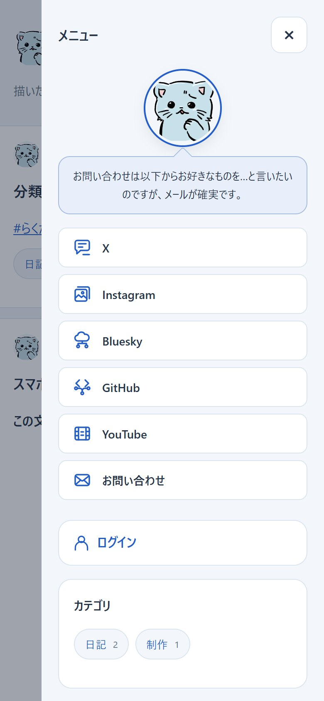<br>MENU</td>
<td align="center">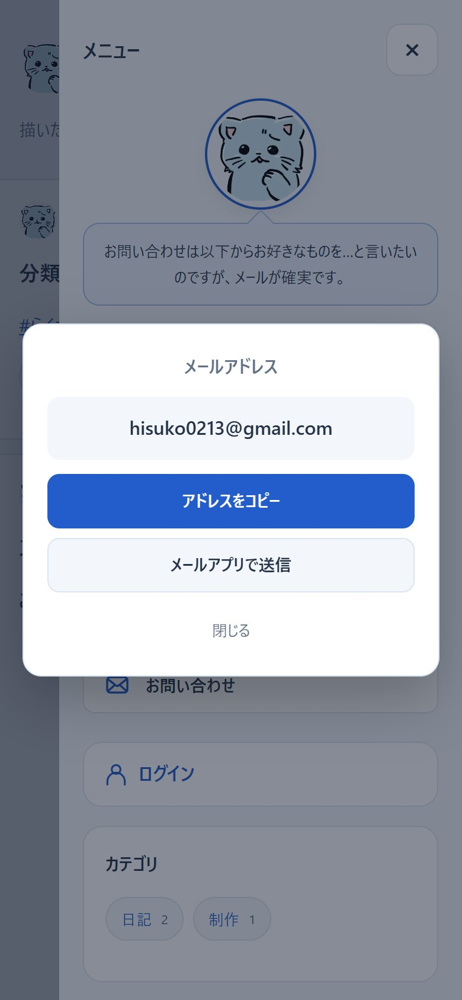<br>Mail dialog</td>
</tr>
</table>

**Logged in**: the posting box appears at the top of the top page. Pictures, video and audio line up as thumbnails under the text, and marks such as "メディア1" (media 1) in the text show where they go. Categories, content warnings and the like open below only when their tool icon is pressed. Chosen items are shown as chips under the text.

Scroll down and a "書く" (Write) button aligned with the right edge of the sidebar appears. Other pages (posts, search, categories) do not show the posting box; the Write button floats in right after they open.

<table>
<tr>
<td>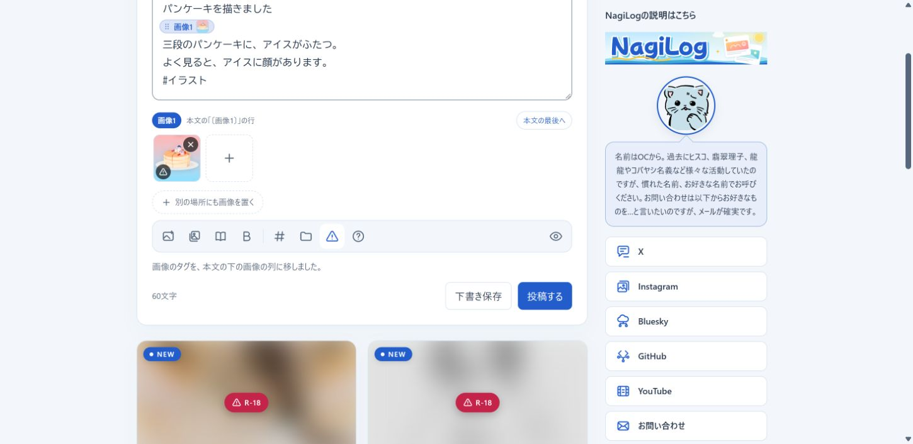</td>
<td>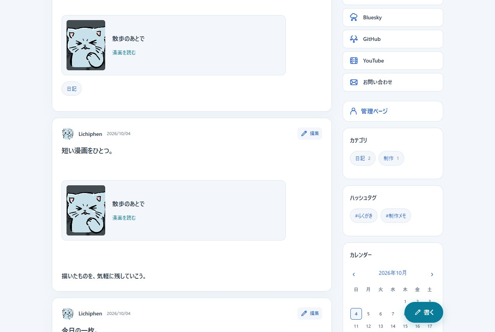</td>
</tr>
</table>

**404**: drawn as the inside of a black hole. Beige bands ripple and waves of light strike again and again.

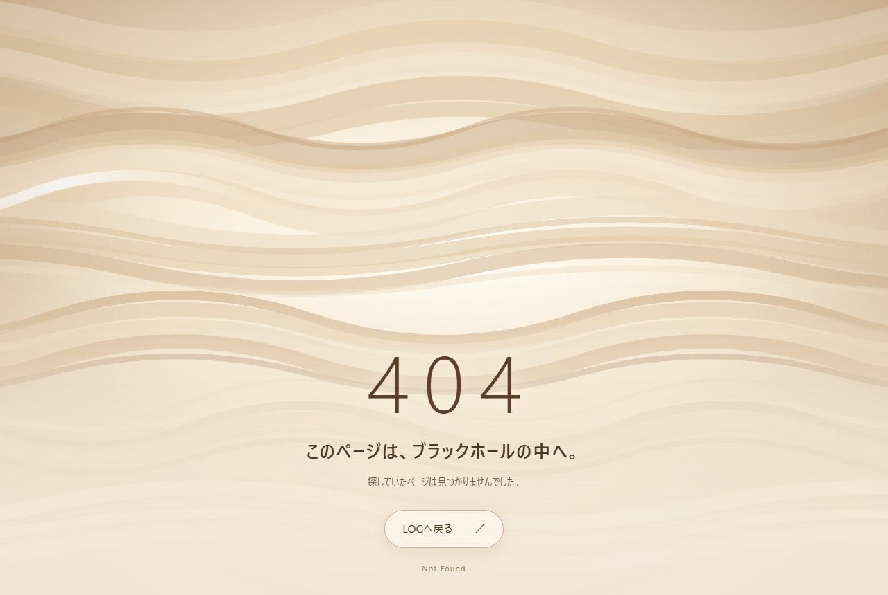

## What it does

| Feature | How it works |
| --- | --- |
| Posts and drafts | Logged in, you write at the top of the top page. When the posting box scrolls out of sight, "pen + Write" appears. On computers it is aligned with the right edge of the sidebar. The button rises from below, and a "spanner + Admin" button slides in above it. Other pages do not show the posting box; the two buttons float in right after they open. |
| Bold and links | Selected text can be made bold with "B" in the tool row. A line selected by triple click keeps its line break outside the bold. URLs in the text become links. HTML is shown as text. |
| Embeds and cards | Paste only a URL on a line, and YouTube, X and others are embedded by looking at the domain. Other pages are shown as blog cards from their OGP. |
| Pictures | Add them by choosing, dropping or pasting. Thumbnails are grouped, and marks in the text decide where each group goes. Public pictures can be zoomed with NagiSwipe, and GIF animations keep moving. |
| Video and audio | Added the same way as pictures. Audio gets a waveform player with gapless repeat; covers and loop points can be written into the song. Videos can play like a GIF (muted, by themselves, over and over). |
| Content warnings | Posts and pictures can be marked "sensitive", "R-18" or "R-18G". Readers see sensitive pictures blurred; R-18 and R-18G posts are folded and ask for the reader's age before opening. Two presses in the posting box set it. |
| Manga | Choose from recent works by title and cover. A manga card in the post opens the viewer on the spot. |
| Editing and replacing | Posts can be edited. "Media list and replace" changes a picture's description or the picture itself. |
| Categories | Made and chosen while posting. Names and order are changed under "Categories and tags" in Log and posts. |
| Hashtags | `#doodle` and the like in the text become links. The posting box shows the 8 used most recently. They can be renamed and reordered from Log and posts. |
| Mail | A mail address can be put in the links. Visitors who press it choose to copy it or send with their default mail app. |
| Search | The search box in the side menu searches text, titles, hashtags and category names. The post list in the admin panel has a search box too, which also finds drafts. |
| Side menu | The profile and links, search, a calendar, the 3 latest public posts, categories, hashtags and the last update date. They can be reordered and hidden in the settings. |
| HTML boxes | For advanced users: add them from templates for grid links, borderless banners and free HTML. |
| Phones | Posts take the full width. A button with three lines and the word "MENU", following at the top right, opens the menu. |
| Design | 3 light and 3 dark designs. An icon and a common OGP picture can be set. |
| Favicon | Choose one 512 × 512 px picture, and favicon.ico, the iPhone and Android home screen icons and the web app manifest are made automatically. |
| 404 | Pages that are not found show an animation of the inside of a black hole. It honors the device's "reduce motion" setting. |
| Staying logged in | You stay logged in for 30 days from the last login, or 1 year (365 days) in the settings. |
| Audience | Public to everyone, or a private Memo. A Memo shows posts and log pictures only when you are logged in. |
| Paging | Under a list: "新しい投稿" (newer posts), "過去の投稿" (older posts) and page numbers 1, 2, 3… The total and the current position (for example "51–60 of 124") are shown too. Post pages show the previous and next posts and "すべての投稿" (all posts). |
| Sharing | On a public log, "Share" and "Copy" are under each post. Both use "post title + line break + post URL". Share opens the device's share sheet on phones, and on computers a chooser for X, Hatena Bookmark, LINE and Instagram. Instagram has no share URL that takes text, so it copies the text and then tells you to open Instagram. The icons are original drawings, not the services' official logos (`server/viewer/link-icons/README.txt`). |
| Likes | A heart button left of "Share" under each post. A tap adds 1, holding adds 10 at a time. The same line and the same device can press at most 100 per post per day. It can be turned off in the settings. The count can be seen, changed and cleared on the post's edit screen. |
| List style | "Microblog", showing whole posts, or "tiles" with a thumbnail, date and title. New posts get a "NEW" mark (the period and the text are set in the settings). |
| Related posts | Six posts of the same category or hashtags under each post. Random, or most recently updated first. |
| Pinned posts | Like “stick to the top” in WordPress, posts can be shown first on the top page. Pin several (up to 30) and reorder them in the admin panel; the admin post list shows them at the top too. |
| Password locks | Posts and fixed pages can have a password. Readers see only the title and a field; the text and pictures appear only after the right password. The opened state is kept in a cookie, and browsers are never asked to save the password itself. |
| RSS and sitemap | RSS for the whole log, per category and per hashtag. The settings screen makes the URLs to copy. A sitemap for search engines too. |
| Search engines | Which pages go into search follows the list style. There is also a setting that keeps every page out of search, for fan works and the like. |
| Post list | Short rows without the text: date and time, title, a small picture, view, edit and delete. Posts with likes show a heart and the count. Bulk delete too. |
| Top menu | Links under the site name to fixed pages, categories, hashtags and so on. On phones they can be swiped sideways. |
| Fixed pages | Pages such as a profile or terms of use, written in Markdown. Pictures can be put in, with a preview before saving. |
| Top page and blog | Turned on in the settings, the top shows a fixed page and the post list moves to `./blog`. Links to the blog can go in the top menu and the footer. |
| Footer | The text at the bottom of the site and links such as HOME and terms are set separately. |
| Backup | A log ZIP saves and restores posts, drafts, pictures, categories, audience, display settings and like counts. |

A post's title is the first line of what you type.
The text shows from the second line on, without repeating the title line.
The title is shown in normal heading type. Bold, URLs and hashtag links work in the text from the second line.
Hashtags in the title line still count for categorizing.
A long title is shown in full as the post's heading, and cut at 80 characters in the side menu and share data.
Picture and manga tags on the first line are kept in the text, so they do not disappear.
A post with only pictures is shown as "画像の記録" (a picture post).

## Strengths

- No database to prepare or migrate. Each post is stored as its own file.
- A public log and a private Memo use the same mechanism.
- Text, art and manga go into the same posting box. Move a group's mark to move pictures, paste a manga tag again to move manga.
- Editing after publishing does not change the URL. Retitling manga or replacing pictures keeps them tied to the text.
- It uses NagiManga's authentication, picture conversion and backup. No separate administrator account or outside service is needed for the log.

## Weaknesses and the scale it suits

It is for small sites used by one person.
There are no multiple authors, comments or follows.
Search is a simple mechanism that looks for words in the stored text. It does not use a full-text search engine that absorbs spelling variants widely.
Sites with very many posts, pictures or concentrated traffic will see longer waits for reading files and saving.
Load tests with large amounts of data have not been done yet.

The text uses a simple format with bold, URLs, hashtags, picture and manga tags and embeds.
Free HTML and word-processor-like editing cannot be used in posts.
The sidebar can have HTML boxes, but the elements and attributes are limited.
Pictures are read again before saving, so data such as shooting information does not remain. GIF animations keep their frames.
SVG can be used too, but its contents are checked and only the elements and attributes used for drawing are kept. Keep your original files separately if you need them.

Posts that use the same picture tag all change when the picture is replaced.
To change only some posts, add it as a new picture.
There is no dedicated screen for deleting categories or hashtags. Renaming, and removing them from each post, are supported.

> [!CAUTION]
> Deleting a post cannot be undone. Pictures used only by that post are deleted too,
> so save a log backup first if you want to keep any of them.

## Installation and login

You need PHP 8.1 or later with GD, fileinfo and mbstring.
Backup and restore and importing manga EPUB also use ZipArchive.
HTML boxes in the sidebar and importing SVG also need PHP's DOM extension.
Use HTTPS, and let PHP write to the storage.

1. Download [the release ZIP (`nagimanga-v0.9.0.zip`)](https://lichiphen.com/tool/link/r/NagiManga) and upload the `nagimanga/` inside it. Send the hidden `.htaccess` files too.
2. The first time, open `/nagimanga/admin/`, paste the "setup key" written in `data/setup-key.php` (read it with FTP), and choose the administrator password.
3. Bookmark the admin URL that is shown.
4. Under "Common and security" in the settings, enter where it is installed as the "Public URL", such as `https://example.com/nagimanga`. Do not add `log.php`.
5. Under "LOG" in the settings, choose the audience, site name, introduction, name, design and icon.
6. Check that `data` cannot be read from outside, and that pictures and manga are shown.

There is no default product password. You set it yourself the first time.
The administrator password is 10 characters or more. The first setup turns on a setting that allows the admin panel only from your current IP address. You can change it later if needed.
"Icon + Log in" on the public log leads to `admin/login.php`.
Since v0.10.0 a new install starts with "secret login URL only", which hides this link and closes `admin/login.php`. For the LOG, bookmark the "For NagiLog" URL, the login URL with `&p=log` added (shown under Login URL in the settings). The login page also lets you choose whether NagiLog or NagiManga opens after logging in.
Either way in is guarded by the password (or a passkey), the IP restriction and the limit on attempts.
Five failed logins within 15 minutes from the same IP address block logins for a while.

You stay logged in for 30 days from the last login, even after closing the browser.
"Keep me logged in for" under "Settings → Common and security" can make it 1 year (365 days).

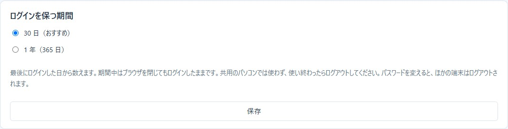

> [!TIP]
> Log out after using a shared computer. Changing the password logs out your other devices.
> Taking the same cookie into another browser does not log it in. A browser update that changes its version keeps you logged in.
> Guests (view only) end after 30 minutes without activity, or 12 hours after entering.
> When using the IP restriction from a phone, mind the difference between home Wi-Fi and the mobile network.

To install from the source, copy the contents of `manga/server/` plus the repository's
`NagiSwipe-main.js` and `NagiSwipe-main.css` into `viewer/` of the installation.
The release ZIP includes these two files.
To update an existing installation, make a backup first and then upload the program over it.
Do not overwrite your own `data/` and `lib/paths.php`.

## Settings and audience

The settings are split into the tabs "NagiMANGA", "LOG" and "Common and security".
Manga work pages are set under NagiMANGA, the log's audience and design under LOG.
Login, the storage URL, the picture limits and bot measures are common.
Input stays when you switch tabs. The left and right arrow keys move between tabs too.

There is only one save button, "Save settings", fixed at the bottom of the screen. It saves what you changed in all three tabs together.
Changed blocks get a line at their left edge and a dot in the table of contents. Next to the save button are the names of blocks not yet saved.
Only the changed blocks are sent. If any one has an error, none are saved: the block's tab opens, the error is pointed out, and what you typed stays on screen.
After saving, the screen reloads and shows the values as the server cleaned them up.
Changing the administrator password and the login URL take effect at once, so each has its own button.

Leaving the page with unsaved changes opens a confirmation: "Back to editing", "Leave without saving" or "Save and leave".
It also asks for menus, links and logging out, and for the browser's Back and the phone's back swipe. Closing or reloading the tab gets the browser's own confirmation.

The settings screen has a table of contents. On computers, the left column lists the blocks of all three tabs.
Pressing one switches to its tab and moves to the block, and the block you are reading is highlighted in the contents.
Wide screens also use two columns, contents and settings. Setting blocks are in one column so that fields do not stretch too wide.
On phones, a "Contents" button floats at the bottom right (above the save button). It opens a contents screen, and one press moves even to a block in another tab.
At the top of the contents are "Back to the admin panel" (Log and posts) and "View the public page" (new tab), shown on the phone contents screen too, so you can move from anywhere.
When a block has subheadings (such as "New mark" and "Start of the breadcrumbs"), their names are shown as labels under the block name. Pressing one moves to that item and opens a closed section. The contents list only block names.

The example below has the "LOG" tab open. The phone contents also show the settings of all three tabs together.

<table>
<tr>
<td>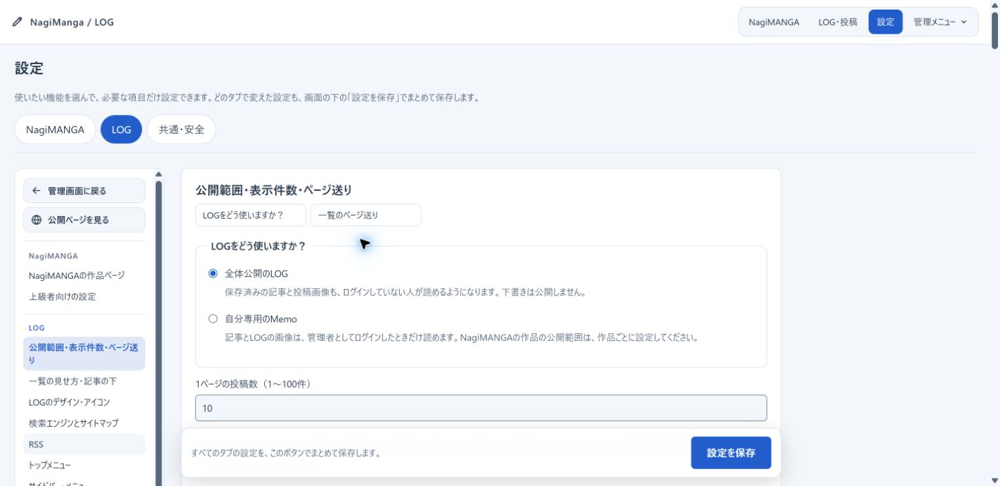</td>
<td align="center">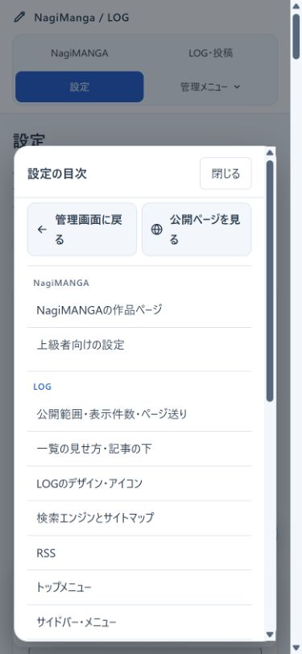</td>
</tr>
</table>

The log is public by default. As a "private Memo", posts and log pictures can be read only by the administrator.
Visitors who are not logged in, guests and expired sessions get 404 for lists, posts, category pages and pictures.
Pages and pictures while logged in use `private, no-store`, and public pages `Vary: Cookie`.
If you were already logged in before, open the admin panel once more and your cookie moves to the new scope.

> [!WARNING]
> Switching a Memo to public publishes the saved posts and log pictures too. Drafts stay unpublished.
> Pictures someone saved after they were public, and caches already held by outside services, cannot be taken back.
> NagiMANGA's works have their own audience, separate from the log. Manage them with work passwords and the like.
> A Memo still needs direct access to the storage to be denied. See "Protecting the storage" below.

The site menu shows "ログイン" (Log in) to visitors and "管理ページ" (Admin page) to the administrator.
Turning off the "Log in / Admin page" switch under "Settings → LOG → Sidebar and menu" hides this block.
Bookmark the admin URL before hiding the entrance.
Turning the switch off opens a confirmation showing the admin URL. "Copy URL" and "Open in a new tab" help you bookmark it, and it turns off only with "I bookmarked it (hide)". "Not yet (keep showing)" and the Esc key keep it on.
Opening the admin URL (without the key) while logged out goes to a password-only login screen as long as "Log in" is shown. After logging in, the post list of the admin panel opens. When the link is hidden, or with a wrong key, it stays 404 as before.
The login entrance and the password protection remain even when the setting is off.

| List | Default count | Where to change it |
| --- | --- | --- |
| Top, dates, months, categories and tags of the site | 10 | "Posts per page" under "LOG" in the settings. 1 to 100 for all. For tiles, an even number is recommended. |
| Post list of the admin panel | 20 | "Rows per page" above the list. 1 to 100. Below it is the same numbered paging as on public pages (the media list too). |

The admin panel remembers its count only for that login session.
It is separate from the public count, so readers' paging is not affected.
The admin list uses no table: short rows with date and time, title, thumbnail, view, edit and delete.
Long titles are cut in the list. The edit screen shows the original input.

Public paging is chosen under "Settings → LOG → Audience, counts and paging".

| Style | Shown | Suits |
| --- | --- | --- |
| Numbered (default) | "Newer posts", "Older posts" and page numbers such as `1 … 5 6 7 … 13`. With 8 pages or more, a field to type a page number appears too. | Logs with many posts whose readers want to go back to where they were |
| Newer and older only | Two buttons, "Newer posts" and "Older posts" | Logs with few posts, or that want a clean look |
| More | A button that adds the next posts below on the same page | Logs read continuously on phones |

Every style uses ordinary links. The next page opens without JavaScript, and search engines can follow page 2 and on.
There is no "infinite scroll" that loads more by itself: the footer and side menu would be out of reach, and the reading position is easily lost when coming back.
After loading with "More", the address changes to the number of the loaded page. Reloading shows from that page, and "最新の投稿から見る" (from the latest posts) goes back to the start.
"Newer posts" is fixed on the left and "Older posts" on the right. On the first and last pages they stay in place as buttons that cannot be pressed, so repeated presses never shift.
On phones, page numbers are on top and the two buttons below at full width.

You can also choose these two; both are on by default.

- The total and the current position, such as "51–60 of 124"
- The previous and next posts and "All posts" under a post's page

"All posts" looks the same as a button in the side menu, category and tag lists and post pages, with the total count.
Page numbers beyond the last page (for example `?page=99` when there are 13 pages) return 404 instead of an empty list.

## Keep using it locally

The log you are working on can be checked at `http://127.0.0.1:5197/`.
Even after the server is stopped, run this in PowerShell from the root of the repository
to start again with the same posts, pictures and settings.

```powershell
powershell -NoProfile -ExecutionPolicy Bypass -File .\manga\dev\start_preview.ps1
```

From a PowerShell opened in any folder, give the file's absolute path.
This example has the repository at `D:\000_tool\NagiSwipe`.

```powershell
powershell -ExecutionPolicy Bypass -File D:\000_tool\NagiSwipe\manga\dev\start_preview.ps1 -Lan
```

When running it from the input box of Claude Code, put `!` in front. In a PowerShell you opened yourself, do not add `!`.

The storage is `manga/dev/results/log-preview-data`. From the second start on, the data is not made again.
Stop with `Ctrl+C`. If a server is already running on 5197, it only says so.
If another app uses the port, change the number, as in `-Port 5199`.

The first start restores posts, pictures, manga and settings from samples on this PC (the two ZIPs in `manga/dev/sample/`).
The samples are material for checking, so they are not in the repository or the release ZIP. Without the ZIPs, it starts with an empty log.
The sample administrator password is `log-test-password`. Use it only for checking on this PC.
The ZIPs are made by the app's backup, so they hold no password hash, secret key or login key. Each installation makes new ones.
Making the samples needs Python 3.

| Extra option | What it does |
| --- | --- |
| `-Lan` | Lets phones on the same Wi-Fi open it and shows the URL for phones. If the page never finishes loading on a phone, check that Windows Firewall is not blocking connections to `php.exe` (it happens easily when the Wi-Fi is a "Public" network). |
| `-Reset` | Starts over from the samples. The current storage is kept under a name with the date and time. |
| `-Empty` | Starts with an empty log without the samples. Choose the password from the admin URL. |

To make the current preview the new sample, run `python manga/dev/sample_data.py export` while the preview is running.

The `demo-site` rehearsal is a separate tool that makes temporary data for the sample manga every time.
To keep using this log, use the start method above.

## Public URLs

| Page | URL example |
| --- | --- |
| Top | `https://example.com/nagimanga/` |
| A post | `https://example.com/nagimanga/20261004123033` |
| Category | `https://example.com/nagimanga/?category=abcdef123456` |
| Hashtag | `https://example.com/nagimanga/?tag=らくがき` |
| Date and month | `?date=2026-10-04` / `?month=2026-10` |
| Fixed page | `https://example.com/nagimanga/profile` |
| Blog (with [Top page and blog](#top-page-and-blog) on) | `https://example.com/nagimanga/blog` (categories and so on: `./blog?category=…`) |

Posts and fixed pages have URLs without `?`.
The bundled `.htaccess` sends `./20261004123033` to the post and `./profile` to the fixed page (`mod_rewrite` on Apache or LiteSpeed).
The old `./?id=20261004123033`, `./?pg=profile`, `log.php?id=…` and URLs with a trailing `/` redirect to the new URLs with 301.
Links and bookmarks people already have keep working, and search engines move to the new URLs.
On servers that do not apply `.htaccess` (nginx and others), the LOG notices that the rewrite is not there and keeps using `./?id=…` and `./?pg=…`, without redirecting.
A fixed page whose URL name equals a folder of the LOG such as `admin` or `viewer`, or looks like a post number, keeps `./?pg=…`; such names cannot be chosen for new URL names.

Above each post, only the date (for example `2026/10/04`) is shown, as the link to the post. The time appears on hover.
The post number is the year, month, day, hour, minute and second (Japan time) of its first publication.
Posts in the same second get a serial, as in `20261004123033-02`.
Drafts use a temporary number that changes to the date and time number when first published.
A post turned back into a draft after publishing keeps the same URL when published again.

The old `log.php` and `log.php?id=…` redirect with 301 to the new URLs.
Make `index.php` the directory index on the server.
Taking the PHP file name out of the URL does not by itself make anything safer.
Authentication, protecting the storage and checking input are needed separately.

With "Public URL" empty, share URLs are made from the Host of the request.
Set the right URL before publishing, and check that canonical and OGP point to your domain.

## Posts, pictures and manga

Logged in as the administrator, you get the posting box at the top of the top page and an edit button on each post. Opening "Edit" from a public page (a post page or a list) shows "記事ページに戻る" (back to the post) above the edit screen ("公開ページに戻る", back to the public page, when opened from a list). This, "Close" on phones and the dialog after saving take you back to the same post on the page you came from. Opened from the post list of the admin panel, it shows only "Back to the post list".
When the posting box goes out of sight at the top, "pen + Write" appears and opens the posting screen.
Pages other than the top (posts, search, categories, dates, page 2 and on) show "pen + Write" right away instead of the posting box.
In the admin list, "Write new" opens it. In a Memo the save button is "Save memo".

The posting box has the text, the media of the text, chips for set items and one row of tool icons.

| Icon | What it does |
| --- | --- |
| Add pictures, video or audio / Choose from the media list | Places them at the cursor in the text (see below). Video and audio go into the same rows. |
| Choose manga | Puts a manga tag at the cursor in the text. |
| B, I, link | Makes the selected text bold or italic, or a link. Pressing B or I again takes the mark off. |
| Format (A and three lines) | Opens a choice of headings, strikethrough, code, ruby, bulleted and numbered lists, quotes, tables, dividing lines and code blocks (see "Headings" and "Markdown in posts" below). They are gathered here so the tool row stays short on phones. |
| #, folder, warning triangle, ? | Opens recent hashtags, categories, content warnings or help below the tool row, one at a time. |
| Eye | Opens and closes the preview. |

On a PC or a device turned sideways, the tool row sits above the text box, and what #, the folder and the others open appears under it (above the text). The preview is switched with the "書く" (write) and "プレビュー" (preview) tabs above the text box and shows in the text box's place at about the same height (a long post scrolls inside the frame). The eye switches it too.
"本文へ" (back to the text) next to the heading closes the preview, an open panel and the media list tab, scrolls the text box into view and puts the caret back where it was. It is filled in while the preview or a panel is open, or the text box is out of sight.
On a PC 1600px wide or more, the edit pages of posts and fixed pages are wider (1100px to 1440px). Lists such as the post list, and the posting box on the top page, stay as they are.
A "Media" panel stays open on the left: as a column left of the text when the posting screen is open full screen and on the edit page, and floating in the left margin beside the posting box on the top page (not shown when the margin is too narrow). The floating panel tucks away upwards while scrolling down and comes back when scrolling up.
- "この投稿" (this post), the tab shown first: the media groups in the text (thumbnails, reordering, content warnings, +) are listed here instead of under the text box. The number on the tab is how many media are in the post. With none yet, it offers buttons to add files or open the media list.
- "メディア一覧" (media list): search pictures, video and audio by description, and press one to put it at the cursor in the text. "Choose from the media list" on the tool row moves to this tab's search. Uploads join the top of the list.
With the column on the left, the text box is taller and "Save draft" and "Post" stay at the bottom of the screen.
On a phone held upright, the tool row sits right under the text box, with the thumbnails of the media in the post under it. The eye opens the preview over the whole screen, at the same size as the post on the public page; "閉じて編集に戻る" (close and keep writing) stays at the bottom while you scroll (Escape closes it too). Pictures in the preview open large as on the public page. Turning the phone sideways while it is open switches to the "プレビュー" tab. Tools that do not fit scroll sideways, and the end with more shows a see-through fade and an arrow (pressing the arrow scrolls too). The eye stays at the right end.

Setting a category or content warning shows it as a chip under the text. Pressing a chip opens that setting.
Pictures, video and audio (media) line up as thumbnails under the text box, like a social media post. The text box does not show media tags.
Media are shown one row per **group**, such as "メディア1" and "メディア2" (media 1, media 2), and each group's place in the text can be chosen.
- Added media go at the cursor in the text, on a mark line such as `〔メディア1〕`. Even at the end of the text a mark line is put in, so looking at the text box tells you where they went.
- If text follows the cursor, the mark line is made below that line (above it when the cursor is at the start of the line). A sentence is never split. When the cursor is on a mark line (or at the start of the line just below it), the media join that group. Media added at once go into the same group.
- The place is announced from the moment sending starts, in the message under the box (such as "本文のカーソル位置（「〔メディア2〕」の行）に置きます", placing at the cursor, on the 〔メディア2〕 line), and the band in the text and the group's row under it light up. If the band is out of view, the text box scrolls to it.
- Adding with a group's + puts them in that group, wherever the cursor is.
- A reopened post also shows every group with a mark line, the group at the end of the text included.
- "本文の最後へ" (to the end of the text) removes the mark line, and that group goes to the end of the text (groups without a mark are at the end of the text).
- To put a group in the middle of the text, "カーソルの位置へ" (to the cursor) on the group puts a mark line at the cursor too. On saving, the line is replaced by the group's tags.
- To put media in another place as well, press "別の場所にもメディアを置く" (place media elsewhere too). A new mark line and an empty group are made at the cursor. Add with the group's +.
- Mark lines in the text are drawn as a band in the theme's accent color with small thumbnails. Dragging a band moves its mark line to another line (it goes above the line where you let go; below the last line means the end of the text).
- Dragging thumbnails reorders them within a group or moves them to another group. On phones, hold first and then move. With the keyboard, select a thumbnail and use the left and right arrows to reorder, up and down to move to the previous or next group.
- The × at the top right removes it from the post. The file itself stays in the media list.
- Numbers do not change while you write (undoing a deleted mark brings back the same group). Reopening the post numbers them again from the top.
- Older marks in the form `〔画像1〕` still work.

An example with media placed in the middle of the text. The marks in the text match the rows of thumbnails below. "本文の最後へ" removes the mark and moves the group back to the end of the text.

<table>
<tr>
<td>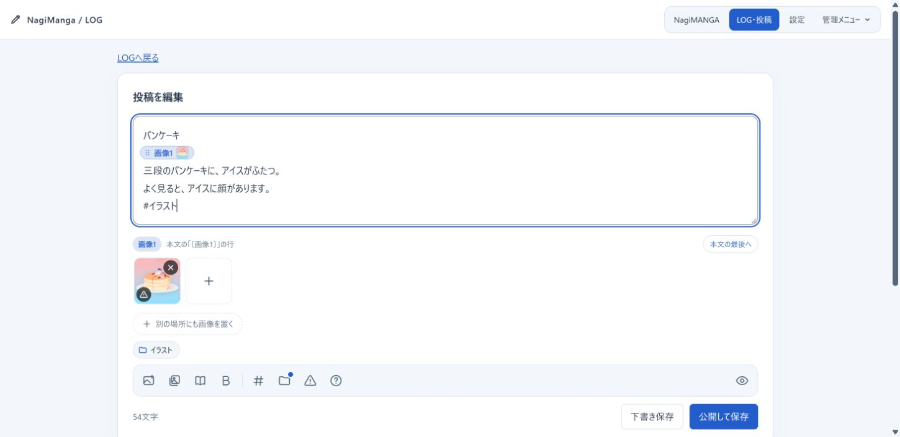</td>
<td align="center">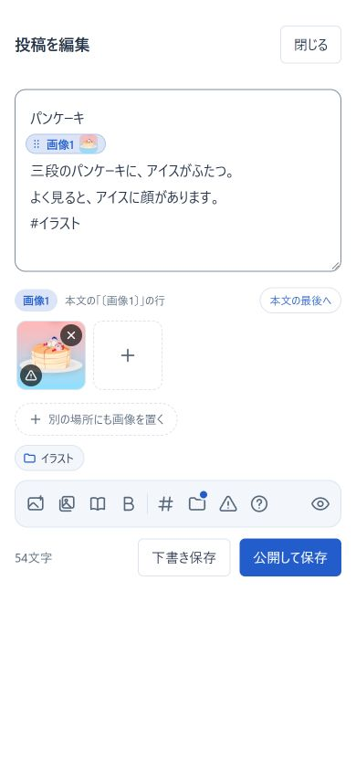</td>
</tr>
</table>

Picture tags typed or pasted into the text box move to a new group, with a mark line where the tags were.
Posts in the older form (picture tags written in the text) are split into groups by their runs of pictures when opened. Even if they are in two or more places, they can be edited as they are.
Dragging a thumbnail or a picture in the text into the text box does not upload the same picture again.

Write the text and choose "Post" or "Save draft". The text can be up to 100,000 bytes.
Unsaved input is also kept in this tab's storage.
It does not sync to other devices and is not a real backup, so save when you finish.
An unfinished entry in the "Write" box of public pages comes back in other posts opened in the same tab. While there is one, the Write button has a dot.
"書きかけを消す" (discard the unfinished entry) removes it.
The confirmation before leaving a page appears only when you typed on that page. An entry that was only brought back stays in the tab, so it does not ask.
If the post was edited first in another tab, it does not save over it and tells you to open it again.

The picture tag is `[Image:picture number]` and the manga tag `[Mangatitle]`.
The stored text writes pictures and manga with these tags. Manga tags, and picture tags of older posts, can be cut and pasted to move them in the text.
Picture tags on consecutive lines become a gallery of square thumbnails (the same form as NagiMemo). Two columns on phones; on computers three columns from three pictures. Two and four pictures are in two columns on computers too. Text between them makes separate galleries, and a single picture is shown in its own proportions as before. Pressing one zooms the original.
Text on the line right after a picture, gallery, manga card, embed or blog card follows it without a blank line. Put one blank line in when you want space.
Manga with the same title are told apart by a number added to the tag.
Manga stay tied by their work ID after retitling, so older posts can still read them.

Password-protected manga do not show their cover on public cards and ask for the password when read.
Manga whose work page is private also use the common picture on cards.
When not logged in, log drafts and pictures used only by them give 404.
On a public log, the icon and the common OGP picture are public too.
In a private Memo, these pictures can also be read only when logged in as the administrator.
Deleting from the media list protects pictures used by posts, drafts, the icon, the common OGP and the sidebar.

### Headings

Start a line with `## ` to make it heading 2 (h2), with `### ` for heading 3 (h3) and with `#### ` for heading 4 (h4). A line with a single `#` is a hashtag, not a heading. On public pages, heading 2 has an underline and heading 3 a line on the left.

Without writing Markdown, use "装飾" (Format) in the posting box. It opens a choice of headings, lists and more.

- With text selected, its lines become headings. With nothing selected, the line with the cursor.
- On an empty line it puts `## 見出し` and selects "見出し", ready to be typed over.
- Choosing the same heading again turns the line back.

"Settings › LOG › List style and below posts › Headings in the editor's Format menu" chooses which headings the window offers. Headings left out still work when typed in the text.

### Table of contents

A post with four or more headings (h2 to h4) gets a table of contents right above its first heading 2 on its own page. Pressing an entry moves to that heading. Lists such as the top and categories do not show it. Fixed pages get one on the same terms.

The same table of contents appears once more, depending on the screen:

- On a wide PC screen (1500px or wider; 1200px for a narrow one-column fixed page), it stays beside the article on the left while scrolling. A round highlight moves to the heading being read, and the bar on top shows how much is read.
- On narrower screens and phones, a "目次" (Contents) button appears at the bottom right once the list in the article has scrolled away. Its ring shows how much is read; pressing it opens the list in a sheet from the bottom. Logged out, the button takes the place of "書く" (Write); logged in, it sits above "書く" and "管理" (Admin) without covering them.
- Posts folded as R-18 or R-18G do not get it.

"Settings › LOG › List style and below posts › Table of contents" chooses "畳んで表示" (folded, the default), "開いて表示" (open) or "表示しない" (hidden).

### Markdown in posts

Post text takes the same Markdown as fixed pages (see the table under "Fixed pages"), with these differences:

- Line breaks and blank lines stay as typed; text is not split into paragraphs.
- Headings start at `##`. A single `#` is a hashtag.
- `#tag` becomes a hashtag link. A line with only a URL still becomes an embed or a blog card.
- Code inside ```` ``` ```` is never turned into headings or embeds. Long lines wrap instead of scrolling sideways, and the COPY button on the frame's top right corner copies the code as it is (posts and fixed pages alike).

### Ruby (reading aids)

The text of posts and fixed pages, and a post's title (its first line), take ruby written the way Aozora Bunko and Japanese novel sites do. The reading is shown small above the words.

| Syntax | Shown as |
| --- | --- |
| `\|親文字《おやもじ》` | "おやもじ" above "親文字". A full-width `｜` works the same as `\|` |
| `漢字《かんじ》` | Only the kanji right before 《 get the reading (the short form without `\|`). Words mixing hiragana or katakana start with `\|` |
| `\|《` | Shows 《 as it is |

- "装飾 › 文字 › ルビ（読み仮名）" (Format › Text › Ruby) in the posting box and the page editor puts `|…《》` around the selected words and leaves the cursor where the reading goes. Selecting the marked words and pressing it again takes it off.
- In a table `|` divides the columns, so use the full-width `｜` there. Inside code the marks stay as typed.
- Where ruby is not supported (some RSS readers), it shows in brackets, like "親文字（おやもじ）".
- Page titles, descriptions, search results and lists show only the base words. Search finds a post by its readings too (`漢字` and `かんじ` both find it).

### Alerts and diagrams (Mermaid)

Posts and fixed pages take alert boxes written as on GitHub, and diagrams written as in Mermaid.

| Write | Shows |
| --- | --- |
| `> [!NOTE]` | 補足 (Note, blue) |
| `> [!TIP]` | ヒント (Tip, green) |
| `> [!IMPORTANT]` | 重要 (Important, purple) |
| `> [!WARNING]` | 注意 (Warning, orange) |
| `> [!CAUTION]` | 警告 (Caution, red) |
| enclosed in ```` ```mermaid ```` | A diagram (flowcharts and sequence diagrams) |

- For an alert, write the mark alone on the first line and the text on the next lines, each starting with `> `. Text after the mark on the same line makes an ordinary quote. Lower case (`[!note]`) works too.
- An alert is a dashed box with its title (Note, Tip…) stuck on the top edge like a round sticker. The class names are GitHub's (`.markdown-alert`, `.markdown-alert-note`, `.markdown-alert-title` and so on), so CSS written for GitHub works as additional CSS. English public pages title them Note, Tip and so on.
- The LOG draws the diagrams itself (no outside library or service). It draws two kinds; others (such as `pie`) show their source as written.
  - Flowcharts (`graph` / `flowchart`, directions `TD` `TB` `BT` `LR` `RL`): shapes `[box]` `(rounded)` `([stadium])` `((circle))` `{diamond}` `{{hexagon}}` `[(cylinder)]` `[[double sides]]` `[/slanted/]` `>flag]`, lines `-->` `---` `-.->` `==>` `--o` `--x` `<-->`, words on lines `-->|yes|` and `-- yes -->`, and groups `A & B --> C`. Colors set with `classDef` or `style` are left out; the LOG theme colors them.
  - Sequence diagrams (`sequenceDiagram`): `participant` and `actor` (`as` for the shown name), messages `->>` `-->>` `->` `-->` `-x` `-)`, `Note left of` / `right of` / `over`, frames `loop`, `alt` / `else`, `opt`, `par` / `and`, `critical`, `break`, and `autonumber`.
- Diagrams shrink to the width of the text. Boxes are drawn as small cards and notes as slightly tilted sticky notes, in the LOG theme's colors. Additional CSS can change them with `.log-dg { --dg-edge: …; }`.
- "拡大" (Enlarge) on a diagram's top right corner opens it over the whole screen, at its own size and scrollable both ways. "−" and "+" (or Ctrl + wheel, or the `-` and `+` keys) change the size, and the percentage fits it to the screen. It helps when reading a detailed diagram on a phone.
- A diagram that cannot be drawn because of a mistake shows the line that could not be read and its source.
- "装飾" (Format) in the posting box and the fixed page editor puts them in: "注意書き" (Alerts) and "まとまり › 図（Mermaid）" (Blocks › Diagram).

## Content warnings (sensitive, R-18, R-18G)

Lets readers prepare before seeing pictures with much bare skin, sexual pictures, or blood and gore.
They can be set on posts and on pictures. A level set on a picture applies to every post, tile and related post that uses the picture.

| Level | Suits | What readers see |
| --- | --- | --- |
| None | — | Shown as it is. |
| Sensitive | Bare skin, light blood and so on | The picture is blurred and opens with "押して表示" (press to show). The text can be read as usual. |
| R-18 | Sexual content | The text and pictures are folded. Before opening, it asks "18歳以上ですか？" (are you 18 or older?). |
| R-18G | Strong blood, violence, gore | The text and pictures are folded. Like R-18, it asks the age before opening. |

<table>
<tr>
<td align="center">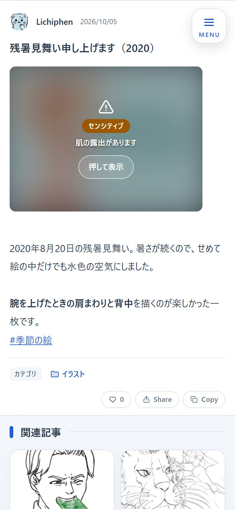<br>Sensitive</td>
<td align="center">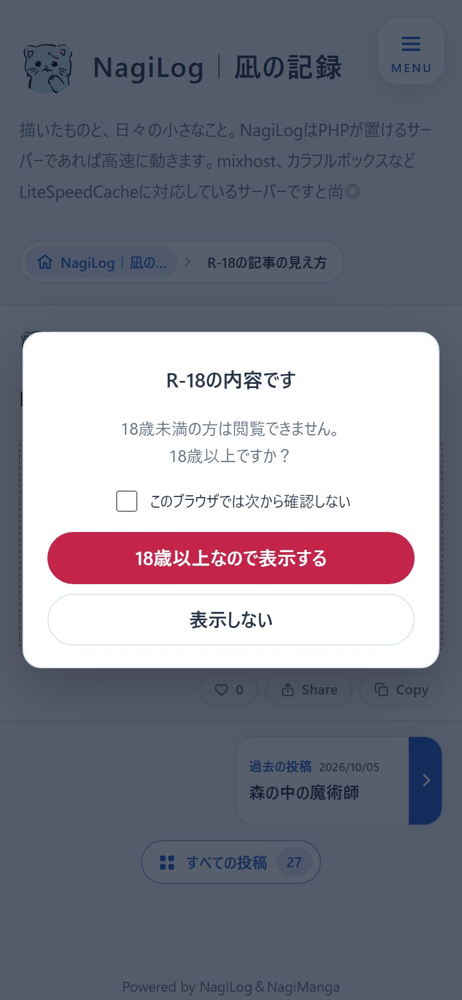<br>R-18 age check</td>
<td align="center">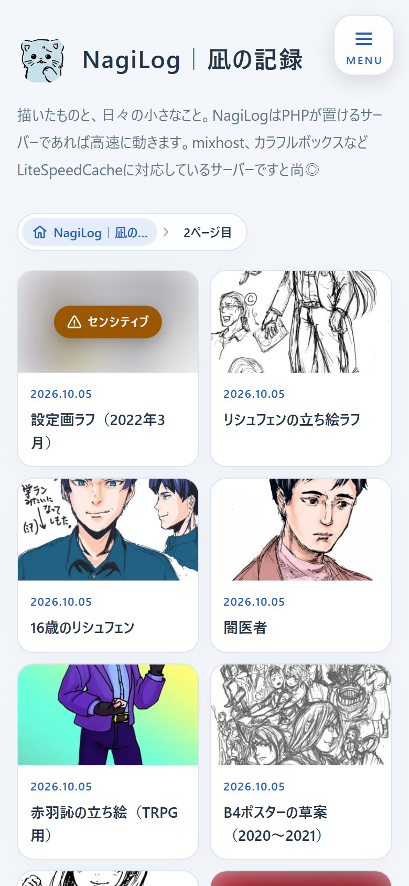<br>Tiles</td>
</tr>
</table>

**Setting them**

- Per post: press the warning triangle in the tool row and choose the level (two presses). Optionally add a note of up to 40 characters, such as "流血表現があります" (contains blood). Pressing one of the preset phrases under the field (blood, bare skin, sexual content, violence, gore, horror, deals with death, insects, "please be careful if this bothers you") puts it in the field to add to. The presets are rewritten under "Settings → LOG → Preset warnings", one per line (up to 40 characters, up to 30). Saving it empty brings back the 9 standard ones. With "選んだとき、本文のメディアにも同じ注意を付ける" (also mark the media in the text) on, the pictures in the text at that moment get the same level.
- Per picture: press the button at the bottom left of a thumbnail under the text and choose the level (two presses). One picture in a post can have a different level.
- Later: change them per picture in "Media list and replace".

The stronger of the post's level and its pictures' levels is used as the post's level. The order of strength is none → sensitive → R-18G → R-18.
For example, a post marked "none" with one R-18 picture is folded as R-18.
The chip in the posting box shows a level that comes from pictures as "R-18（メディア）" (R-18, from media).

**On the reader's side**

- After opening once, it asks whether to show it without asking next time in this browser. If chosen, that browser shows that level from the start and removes the blur on tiles too. "閲覧注意を毎回確認する" (always confirm warnings) at the bottom of the page turns it back.
- The R-18 and R-18G age check is remembered until the tab is closed (answering one, it does not ask for the other). Check "このブラウザでは次から確認しない" (do not ask again in this browser) to open that level without asking from then on.
- While covered, the zoom links of pictures are removed. Flipping to the next picture in NagiSwipe does not show pictures that have not been opened.
- In browsers without JavaScript, pressing still opens it (`<details>`). There is no age check then.

**Sharing and search**

| Where | Posts with content warnings |
| --- | --- |
| OGP (share cards) | If there is a picture without a warning, the first such picture is used. Posts with only marked pictures (and posts marked as a whole) get a WebP made automatically: the picture strongly blurred with the level's name on top ("SEO and OGP" below). Posts with a password lock always blur their first picture and lay a lock over it, with or without a warning. |
| Descriptions and RSS | R-18 and R-18G do not show the text; they say "閲覧注意（R-18）の記事です。" (a post with an R-18 warning). Sensitive posts are as usual. |
| Search engines | R-18 posts are `noindex,follow` and not in the sitemap. |
| Tiles and related posts | Thumbnails are blurred with the level's label. |
| Admin panel | Shown without blur, with the level's label and a note on how readers see it. The post list adds the level to titles too. |

> [!WARNING]
> Content warnings are a sign so that readers can prepare before seeing. They are not access control.
> Opening a picture's URL directly shows it, and the age check is self-reported. Do not post pictures that must not be published at all.
> The title (the first line) is shown without folding. Do not put harsh words in titles.

## Embedding social media and video

Paste only a URL on a line and it is embedded by looking at the domain. No special syntax.
Embedding by pasting a URL is common in other blogs and CMSs too. NagiLog builds it on its own, and pages that cannot be embedded are shown as blog cards from their OGP ("Blog cards" below).
URLs in the middle of a sentence are not embedded but become ordinary links. Put a URL on its own line to feature it, or in a sentence to just mention it.

| What is embedded | Example URLs to paste |
| --- | --- |
| YouTube (videos, Shorts, live, playlists, start time with `t=`) | `https://youtu.be/VIDEO_ID`, `https://www.youtube.com/watch?v=…` |
| Niconico | `https://www.nicovideo.jp/watch/sm9`, `https://nico.ms/sm9` |
| Spotify (tracks, albums, playlists, artists, podcasts) | `https://open.spotify.com/track/…` |
| Apple Music (songs, albums, playlists) | `https://music.apple.com/jp/album/…` |
| Amazon Music Japan (songs, albums, playlists) | `https://music.amazon.co.jp/albums/…?trackAsin=…`, `https://music.amazon.co.jp/playlists/…` |
| SoundCloud (public tracks, playlists) | `https://soundcloud.com/USER/TRACK`, `https://soundcloud.com/USER/sets/PLAYLIST` |
| YouTube Music (songs, videos, playlists) | `https://music.youtube.com/watch?v=…`, `https://music.youtube.com/playlist?list=…` |
| Bandcamp (tracks, albums) | `https://ARTIST.bandcamp.com/track/…`, `/album/…` |
| TikTok (videos, photo posts) | `https://www.tiktok.com/@USER/video/NUMBER`, `/photo/NUMBER` |
| Bluesky posts | `https://bsky.app/profile/ACCOUNT/post/POST_ID` |
| Public Mastodon posts | `https://SERVER/@USER/NUMBER` |
| Mixcloud (public shows, playlists) | `https://www.mixcloud.com/USER/SHOW/`, `/playlists/NAME/` |
| Audiomack (songs, albums, playlists) | `https://audiomack.com/USER/song/…`, `/album/…`, `/playlist/…` |
| Facebook (public posts, videos, reels) | `https://www.facebook.com/PAGE/posts/POST_ID`, `/videos/VIDEO_ID`, `/reel/VIDEO_ID` |
| Public Threads posts | `https://www.threads.com/@USER/post/POST_ID` (`threads.net` too) |
| Vimeo videos | `https://vimeo.com/VIDEO_ID` (unlisted URLs with a hash too) |
| Twitch (live, videos, clips) | `https://www.twitch.tv/CHANNEL`, `/videos/VIDEO_ID`, `https://clips.twitch.tv/CLIP_ID` |
| X (Twitter) posts | `https://x.com/USER/status/NUMBER` |
| Instagram posts and reels | `https://www.instagram.com/p/…`, `/reel/…` |
| CodePen | `https://codepen.io/USER/pen/…` |
| note, Voicy, Steam | URLs of articles, channels and store pages |
| Manga (19 GigaViewer sites such as Shonen Jump+) | `https://shonenjumpplus.com/episode/NUMBER` |
| Video files (mp4, webm, ogv, mov, m4v) | `https://example.com/movie.mp4` |

A post whose first line is only an embed URL gets a title such as "YouTubeの記録" (a YouTube post). Descriptions say "（YouTube）".
With a dark design, X embeds are dark too. Embeds can be checked in the preview as well.

For Amazon Music, paste the link copied with "Share" while listening, as it is, on a line.
For example, `https://music.amazon.co.jp/albums/B0CY5SN6Y4?trackAsin=B0CY5ST1FH` becomes a player for "ポッケ村のテーマ".
Album links without a track, and playlist links, show the track list.
It is Amazon's official preview player, so full playback is not guaranteed.
The inside of the player keeps Amazon's design whatever the post's colors.
Normal share links of `music.amazon.co.jp` are supported. For short URLs, paste the URL they open.

For SoundCloud too, paste the normal link copied with "Share" on a line.
For example, `https://soundcloud.com/sei_peridot/sets/peritunematerial` becomes a playlist with its track list.
Tracks are shown in a player with a visible waveform and do not play just by opening the page.
URLs in the middle of a sentence stay ordinary links. For short URLs, paste the URL they open.
Private links are not supported. Tracks that do not allow embedding, or were deleted, follow SoundCloud's display.

YouTube Music URLs are shown in YouTube's player.
For Bandcamp, Bluesky and Mastodon, the track or post is checked when saving or previewing.
If it cannot be checked, a link to the original page is shown.
For Mastodon, for example, it checks that the official embed address the server returns matches that post.
HTML received from outside is never pasted into the text as it is.

The checked information is stored in `data/log/embeds/`. Saving again within a week does not fetch it again.
If fetching failed, saving or opening the preview from the next day on checks again.
As with blog cards, the public address fetched, time, redirects and size are limited.
When readers view a post, the stored information is used and nothing outside is asked.
Right after moving (restoring a backup, for example), this information is missing. Opening posts and lists while logged in as the administrator fetches what is missing on the spot (saving the post again fetches it too).

Frames of the added services also get a link that opens the original post.
Facebook frames change their height to fit the post.
Facebook, Instagram, Threads and others may show differently depending on privacy settings, login state, region and cookie settings.
Open short URLs and share-screen-only URLs to their normal post URL before pasting.
Twitch is given the installation's domain name automatically. Open the public site over HTTPS.
Twitch frames are at least 400×300px. On small portrait phone screens the player is not shown; instead, "横向きにすると表示されます" (shown in landscape) and a link to open it in Twitch appear.

Embed frames are built by this program from the ID read from the URL.
No `<script>` is written into the text. The official scripts of X, Instagram and note are loaded by `viewer/log-embed.js` only on pages with such an embed.
The security policy (CSP) limits embed frames to the services above, and outside scripts to X, Instagram and note.
YouTube is embedded through `youtube-nocookie.com`, which uses no cookies.

Showing an embed makes the visitor's browser connect to the service. The IP address and so on reach that service, and its cookies may be used.
Deleted and private posts follow each service's display. Write about it in your site's privacy policy if needed.

### Blog cards

A URL that cannot be embedded, pasted on a line, is shown as a card with the page's OGP (title, description, site name, picture).
Pages without OGP use `<title>` and the description. Pages that cannot be fetched stay ordinary links.

Pages are fetched only when the administrator saves a post or opens the preview. Visitors never cause outside fetches by viewing a page.
The fetched contents are stored in `data/log/cards/` and fetched again when the post is saved a week or more later. Pages that could not be read are tried again on saves from the next day.
Card pictures are brought into this server, reduced, read again and saved. Visitors' browsers do not connect to the outside site, and data hidden in the picture does not remain.

Because it reads outside pages, it has these limits:

<details><summary>Limits when fetching blog cards</summary>

- Only ports 80 and 443 of `http` and `https` are read. URLs with a user name or password are not read.
- If the name resolves to loopback, internal ranges, link-local (including cloud metadata), CGNAT or reserved ranges, it is not read. It connects only to the checked address, which also prevents swapping the name resolution.
- Up to 3 redirects, each checked the same way. Pages up to 1MB, pictures up to 8MB, at most 10 per save and 20 seconds in total.
- Shift_JIS and EUC-JP are handled. Card text is not interpreted as HTML but escaped.

</details>

Log backups do not include the stored cards. On the new server, saving the post again makes the card again.

### Page embeds

Pages not on the list above can also be shown in a frame inside the text: write `[Embed]URL[/Embed]` on a line of its own. It suits pages that fill the whole window, such as games played in the browser. It works in posts and fixed pages alike.

| Notation | Shown as |
| --- | --- |
| `[Embed]https://example.com/game/[/Embed]` | A wide (16:9) frame |
| `[Embed 4:3]https://example.com/game/[/Embed]` | A frame of the given shape (`16:9` `4:3` `3:2` `1:1` `2:3` `3:4` `9:16` `21:9`) |

- At first a cover is shown, and the page loads only when the reader presses Load the page, so a heavy game does not load just because someone scrolled past it (a phone short of memory may close the page). The cover shows the page's title and picture, fetched as for blog cards.
- Full screen under the frame spreads it over the whole screen. Browsers without full screen (an iPhone, for one) spread it over the window instead. Close on the top right corner goes back.
- The frame is at most 80% of the screen's height; tall shapes get narrower to fit. A link under the frame opens the page in a new tab.
- `[ページ埋込]URL[/ページ埋込]` works too. The Format window of the post and fixed page editors puts one in from Blocks › Page embed.
- The page goes into the frame through this site's `embed.php`. `embed.php` opens only URLs this site signed when it drew the text, so nobody can show another page under this site's address. The public pages' CSP never needs to list the other site.
- The page in the frame can use scripts, storage (saved games), full screen and gamepads, and can open new windows. It can never move this site's page elsewhere (from v0.12.0, not even when the reader presses a link). Make its outside links open in a new tab (`target="_blank"`).
- Pages whose site forbids frames (`X-Frame-Options` or CSP `frame-ancestors`) cannot be shown. Readers can open them from the link under the frame.

## Picture formats, sizes and management

Pictures can be JPEG, PNG and GIF, plus WebP, AVIF and BMP. Importing WebP, AVIF and BMP needs the server's GD to read each format. Imported pictures are read again on the server and saved as WebP where WebP can be written, JPEG otherwise. Pictures with a side over 4096px are reduced to fit 4096×4096 before saving, as X does (keeping the proportions and transparency). The files get lighter, and zooming on phones breaks up less. A tall picture becomes narrower to match. GIF animations and NagiMANGA's manga pages are not reduced.

GIF animations with two or more frames are saved as GIF. Both the small display in the text and the zoom in NagiSwipe move.
GD cannot write animations, so the GIF is read block by block and rebuilt from only the parts that draw.
Frame pictures, frame durations and the loop setting are kept; comments, custom data and data after the end mark are thrown away.
PHP or HTML hidden in the picture does not survive this rebuild. It is served with `image/gif` and `nosniff` too.
Up to 3,000 frames, and frames × height × width up to 1.5 billion pixels. One-frame GIFs and malformed GIFs are converted to WebP or JPEG as before.

The picture limit can be set from 1 to 200MB under "Common and security → Installation and picture uploads". It is 30MB by default. PHP's `upload_max_filesize` also limits what can be uploaded. Pictures can be up to 16,000px on a side and 50 million pixels in total. They cannot be imported when there is not enough memory to process them.

Picture quality is a common setting too, from 60 to 100. It is 90 by default.

"Media list and replace" (formerly "画像一覧・差し替え", picture list and replace) shows 40 per page, and "Rows per page" above the list changes it from 1 to 100 (remembered while logged in). The search box above finds pictures by their description (at first the file name), the titles of the posts that use them, use as the icon, common OGP or in the sidebar, and the date they were added. "In use / unused" and "with warning / without" (content warnings) narrow it down. After saving a description or deleting a picture, you come back to the same results and page. Each description can be edited up to 300 characters, and you can see the number of uses, the posts using it (links to their edit screens) and use as icon, common OGP or in the sidebar. Replace a picture by choosing "画像を差し替える" (replace the picture) or by dragging and dropping a new picture onto its box. Replacing a picture changes every post and setting that uses the same picture tag. Only unused pictures can be deleted. Pictures used by posts, drafts, the icon, the common OGP and the sidebar cannot be deleted.

Drop pictures onto "メディアだけを追加" (add media only) at the top of "Media list and replace" (dropping anywhere on this screen is the same) or choose them with "ファイルを選ぶ" (choose files) to add pictures without writing a post. Several can be added at once. Pictures for HTML boxes in the sidebar, fixed pages, the title logo and so on can be put there in advance. Dropping onto a picture's box replaces that picture, as before. Pictures that are only added give 404 on public pages until they are used in a post, the sidebar, a fixed page or a setting (they can be seen when logged in). The "URL" and "Markdown" buttons of each picture copy the `./?media=…` URL and the `` line for fixed pages.

In the media list, add pictures only from the box at the top and find the pictures you need with the search box. "URL" and "Markdown" copy the strings to paste into fixed pages and HTML boxes. "画像を差し替える" changes the contents of a picture already in use.

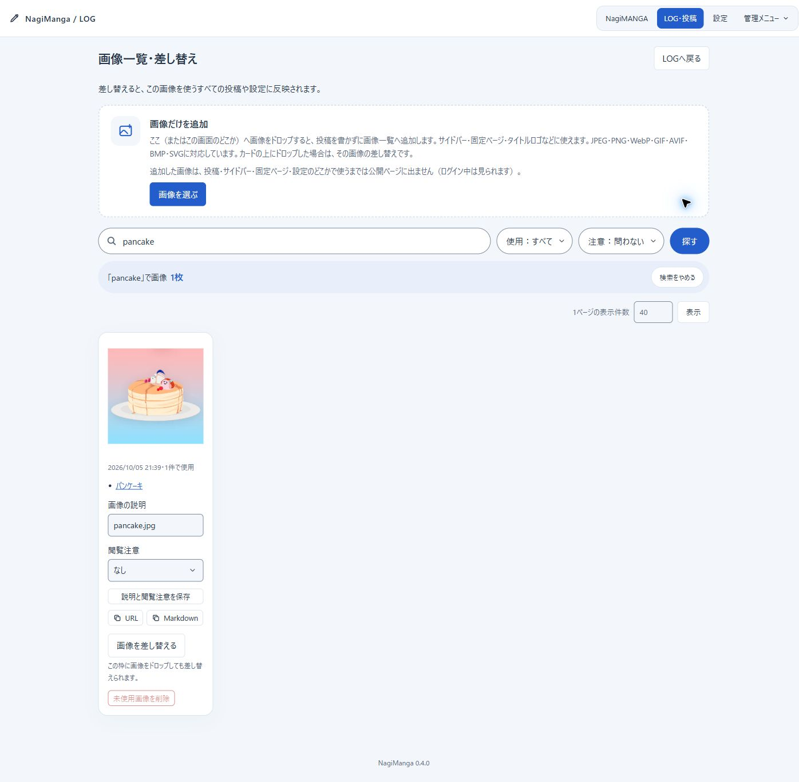

### SVG

SVG can be uploaded too (posts, the media list, the icon, the title logo). SVG is a document rather than a picture and can hold programs and references to other sites. So a simple virus check runs before importing, and SVG with any of the following is refused with the reason:

<details><summary>SVG that is refused (with the reason)</summary>

- `<script>`, `<foreignObject>` (embedded HTML), `<iframe>`, `<embed>`, `<object>`, HTML elements
- attributes that run on events such as `onload` and `onclick` (in any letter case)
- URLs such as `javascript:`, `vbscript:` and `data:text/html` (including ones broken up with spaces or character references)
- references that read outside the file (outside URLs in `<image>`, `<use>` and `<feImage>`, CSS `@import`, outside `url()`, `image-set()`). Only `#id` inside the file and pictures embedded in the file (such as `data:image/png;base64,…`) can be referred to
- animations that rewrite `href` or events (`<animate attributeName="href">`, `<set attributeName="onclick">`)
- DOCTYPE and ENTITY declarations (used for reading outside files and for attacks that swell on expansion), processing instructions such as `<?xml-stylesheet?>`
- CSS escapes (ways of hiding the words above, such as `u\72l(`)
- compressed SVG (SVGZ), files over 2MB, over 50,000 elements, or without a size (width and height, or viewBox)

</details>

SVG that passes is not saved as it is either. Only the elements and attributes used for drawing are written out again; Inkscape and Illustrator editing data, comments, `<metadata>` and unknown namespaces are thrown away. Links (`<a>`) are removed, keeping only the drawing inside. Gradients, filters (such as shadows), clips, masks, `<style>`, text and SMIL animation work as they are. A file named `.png` whose contents are SVG gets the same check, and a file named `.svg` whose contents are HTML is not imported.

Public pages show SVG with ``, so browsers do not run programs inside it. For opening a picture's URL directly, SVG is served with `Content-Security-Policy: default-src 'none'; …; sandbox` and `nosniff`. Social media do not show SVG OGP pictures, so SVG cannot be chosen as the common OGP picture, and posts never use SVG for OGP (the common picture is used instead). SVG restored from a backup goes through the same check as uploads.

## Video and audio

Video and audio can be added too, with "Add pictures, video or audio" in the posting box, by dropping or pasting, or with "メディアだけを追加" in the media list. Like pictures they go into the groups under the text, and in the post the player is shown on its own row, separate from picture groups.

| Kind | Formats |
| --- | --- |
| Video | MP4 (including iPhone MOV), WebM |
| Audio | MP3, M4A, OGG, WAV, FLAC |

- The format is checked from the beginning of the file's contents, not its name. Files pretending to be video or audio are refused.
- Large files are split by the browser into pieces smaller than the server's upload limit and joined on the server. A piece that did not arrive is sent again on its own. Up to 1GB per file.
- The length, video size and audio waveform are measured once by the browser of the admin panel at upload and stored. Readers' browsers do not analyze the audio each time they open a post, so it shows lightly. Audio over 150MB is not measured for a waveform and is shown with a thin bar.
- If the audio file holds a cover picture (MP3, M4A, FLAC, OGG, WAV), it is taken out and shown left of the player. OGG reads `METADATA_BLOCK_PICTURE` (or `COVERART`), WAV the picture in the `id3 ` chunk. Without one, it is a clean form with just the title and waveform. Works in progress can be posted as they are.
- If loop points are written in the song, they are read at upload and stored. Supported are the `LOOPSTART` and `LOOPLENGTH` (or `LOOPEND`) tags used for game music (OGG, FLAC, MP3 TXXX, M4A), and the first loop of a WAV `smpl` chunk. The values are in samples and turned into seconds with the file's sample rate.
- Writing the cover and loop points: the button at the bottom right of a thumbnail in the post editor, or "ジャケットとループ位置" (cover and loop) in the media list, writes a cover picture and loop points into the song file itself (MP3, M4A, FLAC, OGG, WAV). Other tags and the sound stay as they are, and the written file replaces the one on the server. "書き込んだファイルを保存" (save the written file) also saves it to your computer.
  - Covers over 1200px are reduced and put in as JPEG. "ジャケットを外す" (remove the cover) takes it out.
  - Loop points are written as "minutes:seconds.milliseconds" or in seconds, and "今の位置" (here) puts in the playback position below. "つなぎ目を聞く" (hear the seam) plays from 3 seconds before the loop's end, so you can check where it goes back to the start. The playback bar sounds from where you let go, and when moved past the loop's end it plays to the end of the song before entering the loop. The file gets `LOOPSTART` and `LOOPLENGTH` (in samples), and WAV also gets a `smpl` chunk.
  - What is written: MP3 gets ID3v2 (APIC, TXXX), M4A iTunes items (covr, ----), FLAC PICTURE and VORBIS_COMMENT, OGG (Vorbis, Opus) `METADATA_BLOCK_PICTURE` and comments, WAV the `id3 ` and `smpl` chunks. After writing, it is read back and checked before sending.
- Videos use an early frame as the cover. The cover is also used for tiles in lists and for the OGP picture.
- The title of songs and videos is at first the file name (without the extension). Change it with "タイトル" (Title) in the media list.

> [!TIP]
> Both video and audio are stored as they arrive. Rental servers have no way to convert them. Whether they play depends on the viewer's browser: iPhone videos shot in HEVC (H.265), for example, may not show on Android or computers. If unsure, use H.264 MP4.

Players in posts follow the colors of the site's design.

- Audio: the play button, waveform and time on one row. The waveform is the playback bar itself; pressing it plays from there. With the keyboard, left and right arrows move 5 seconds, Home and End to the start and end. While repeating, moving past the loop's end plays from there to the end of the song and then goes back to the loop's start.
- Repeat: the button at the right end of the audio player repeats one song. Pressing it loads the song once in the browser (Web Audio) and joins it sample by sample, so the seam of the repeat has no gap. A song with loop points plays from the start and, at the loop's end, goes back to the loop's start (the intro plays only once). Songs over 8 minutes, and formats the browser cannot read, repeat with normal playback so as not to use too much memory (then the seam has a short pause). On iPhone it plays even in silent mode (the same as normal playback).
- Video: a large play button in the middle of the cover, and while playing a control bar at the bottom (play, playback position, time, volume, full screen). It hides when you stop moving and comes back when you move the mouse or tap the screen. Tall videos are centered in their own proportions.
- How a video plays: choose with the button at the bottom right of its thumbnail in the post editor, or "再生のしかた" (how it plays) in the media list. Choose from four: "ふつう" (normal), "GIFのように" (like a GIF: plays by itself without sound when seen, over and over), "自動再生" (autoplay: once without sound when seen) and "くり返し" (repeat: with sound, over and over, from the play button), and check it at once in the preview on the right. "Normal" and "repeat" can also start without sound. It applies to every post that uses the video.
- Browsers allow autoplay only without sound. A video plays only while at least half of it is in view, and stops outside it. While it plays without sound, a "音を出す" (sound on) button is shown at the top right. A video the reader stopped does not start again by itself when it comes back into view. Readers with the reduce motion setting (prefers-reduced-motion) do not get autoplay. Videos without sound do not stop other players.
- Only one plays at a time. Playing another player stops the previous one.
- With a content warning, the player is folded.
- So that playback can start in the middle, delivery supports Range (returning only part of the file). At most 512KB is returned at a time, and the player asks again for the rest. Phone browsers may ask for the whole file and then stop reading partway; returning the whole file would keep the server's PHP waiting on that connection. Safari on iPhone does not play video without Range. The measures against image-scraping bots do not count the loads in the middle of playback.
- Log backups include video and audio. Large files make the backup ZIP large too, so mind the upload limit of the server you restore to.

## Deleting posts and their own pictures

"Delete" in the post list deletes one post.
When logged in, "Delete" also appears next to "Edit" above each post on public pages (lists and post pages). After confirming, it deletes the post and goes back to the top of the public page.
"Bulk delete" lets you choose posts and delete them at once.
While choosing, the button turns into a dark "× Stop choosing", and the delete bar is shown in a reddish color.
"Select all on this page" covers only the posts on the current page.
The confirmation shows how many are chosen and checks once more before deleting.
The cancel button has the focus at first. The Esc key also cancels.

The originals of the chosen posts, and the pictures, small pictures, picture data and save records used only by them, are deleted.
Pictures also used by other posts, drafts, the icon, the common OGP or the sidebar are kept.
Sharing is checked from the originals of the text, so shared pictures are protected even when the list file is old.
Unrelated unused pictures, manga originals, category settings and the security log are not deleted.

The update numbers of all chosen posts are checked before deleting.
If any post was updated on another screen, the whole deletion stops.
If moving or updating the list fails halfway, the moved posts and pictures are put back.
When it ends normally, the temporary folder is removed and emptied year and draft folders are tidied up.
With too few permissions on the storage or a forced stop, the cleanup or recovery may not finish.

Old edit boxes of deleted posts cannot save.
Records against resending new posts are tidied too, so resending an old new-post box may make a new post.
Deleting and posting again within the same second may reuse the deleted post number.
After deleting, close old posting boxes and open the screen again.

## Categories and hashtags

Categories are chosen and made from "カテゴリを選ぶ・作る" (choose or make categories) in the posting box.
When making new ones, separate them with "、", as in "日記、制作メモ".
Category names are up to 40 characters, and up to 20 per post.

`#doodle` and `#making-notes` in the text become links to posts with the same tag.
Tag names can use letters, digits and underscores. Up to 60 characters, separated by spaces or punctuation.
`#` inside URLs, picture tags and manga tags do not count as hashtags.
Pressing a recently used tag in the posting box inserts it into the text.

"Log and posts → Categories and tags" renames them.
Drag the handle or use the up and down buttons to reorder.
Mouse and touch both work, and the new order is saved on the spot.
Categories show in the site menu and the posting box, hashtags in the site menu.
Under a post, the "カテゴリ" (Category) heading is followed by a folder icon and the category names, separated by "," when there are several.
In the sidebar, categories are a list with folder icons and counts, and hashtags a row of words with "#", so they are easy to tell apart.
The 8 recent hashtags in the posting box follow the usage history, not the manual order.
If categories were also changed on another screen, it does not save and tells you to open the screen again.
A renamed category keeps the same URL number.
Renaming a hashtag also changes it in published texts and drafts.
URLs of the old hashtag name are not redirected.

## Design and cache

Light blue is the default. Light sage, light paper,
dark navy, dark charcoal and dark plum can also be chosen.
Pressing a color sample also selects its radio button, so you can compare them on that screen.
The public site changes after saving. On phones the radio buttons are under the samples.

All six themes meet the WCAG 2.2 level AA color contrast.
Text is at least 4.5:1 against its background (3:1 for large text); field borders, switches and keyboard focus rings at least 3:1.
This was checked including placeholder text in fields, highlights of found words, notices, content warning screens and hover states.
The shadow behind text over pictures with content warnings is set so that it can be read even on a pure white picture.
NagiMANGA's admin panel (light and dark) meets the same standard.

On phones, only the site name's row is kept from overlapping the "MENU" button at the top right; the introduction uses the width up to the right edge.
When the site name has 8 or more characters, the width is estimated from the number of characters and the type is made smaller until it fits on one line (at least 15px), with tighter line spacing. If it is too long even then, it wraps with the tighter spacing.

"LOG → Text at the bottom of the site" shows or hides the footer text and changes it.
The default text is "Powered by NagiLog＆NagiManga". Sites that had saved the old default "Powered by NagiManga / NagiSwipe" show the new default too. One line of up to 200 characters; HTML is treated as text.
Empty means this text is not shown. The footer links are set separately. The license notices of each source stay.

The 404 page draws the inside of a black hole with SVG and CSS. Opinions differ on what it is like inside; this takes the view that it is a beautiful space of dozens of rippling beige bands.
36 bands in six bundles flow at different speeds and directions. Every few seconds a wave of light strikes from the left again and again, and the bands ripple widely from the top down and then calm.
No blur effects are used; it moves only by shifting and stretching the bands, so it hardly flickers.
It loads no outside pictures or JavaScript, and the animation stops with the device's "reduce motion" setting.
The normal 404 response that tells nothing about the page and the instruction to keep it out of search are shared.

Scrollbars are round, in each color scheme. How they look depends on the browser.
The cache busters of JS and CSS are update numbers that change with their contents.
The numbers are noted in `data/asset-versions.php` and computed again only when a file's size or modification time changes.
Versioned JS, CSS, SVG and PNG files are kept by browsers for a year through `.htaccess` on Apache and LiteSpeed (`max-age=31536000, immutable`). The check request on every page change goes away. The pages themselves are checked every time as before (`no-cache`).
A change to only the manga CSS also changes the update number of the loading JS.
Replaced pictures get new version numbers in their URLs too.
There is no way to force share services to drop their OGP caches.

### Footer links

"Settings → LOG → Footer links" lines up links such as terms of use and privacy policy at the very bottom of the page.
They are made the same way as the [top menu](#top-menu). Type part of the name of a fixed page or category in the display name and pick from the suggestions, and reorder by dragging or with the arrow buttons. Press "Save settings" at the bottom of the screen to apply.

First comes a link to the top with a house icon and "HOME". This text is the same as the start of the breadcrumbs and is changed under "List style and below posts". The link to the top alone can be turned off.
Links are shown from the left, and on phones what does not fit wraps. Even when "Text at the bottom of the site" hides the text, these links are shown.

### LiteSpeed Cache

On LiteSpeed servers, the server itself caches the pages of the public log and returns them without running PHP.
Whether it is LiteSpeed is detected automatically. On other servers nothing is sent and everything works as before.
"Common and security → LiteSpeed Cache" in the settings shows whether it is used. On LiteSpeed servers it can also be turned off there.

| Page | Cache |
| --- | --- |
| The public log seen by visitors who are not logged in (top, posts, categories, dates) | Yes (1 hour) |
| The admin panel, pages while logged in, guests | No |
| A private Memo, 404 | No |
| Post pictures and card pictures | No (so that the measures against image-scraping bots keep running in PHP). Instead, visitors' browsers keep them for a day |

People with the login cookie are handled apart from the cache. A cached page for visitors is never shown to the administrator.
Changing posts, pictures, manga or settings in the admin panel, or restoring, clears the log's cache. How it is cleared depends on the kind of change.

| Change | How it is cleared |
| --- | --- |
| New or edited public posts, site name and design, sidebar, footer, order and names of categories, added pictures and descriptions, making and editing manga | The next visitor gets the previous page at once while the new one is made (LiteSpeed's `stale`) |
| Deleting posts, saving as draft, saving audience, counts and paging, restoring, deleting pictures or manga, a work's audience or password | Cleared at once. What was cleared is never shown again |

Visitors right after a post see it without waiting for the rebuild.
To take something down that must not be seen, delete the post or turn it back into a draft. It disappears at once. If you only fix a post, the first visitor right after may see the page before the fix once.
To keep "today" in the calendar right, the cache is rebuilt every hour.
When the program is uploaded over with FTP, the first view notices that the program files' modification times changed and clears the old cache once.
The included `.htaccess` has `CacheLookup on`, which works only on LiteSpeed. If the cache is turned off on the server side, this does not work either.

### Making uncached views fast too

For views that cannot use the server cache (logged in, pictures, the first search, right after a post and so on), it does the following:

| Target | What it does |
| --- | --- |
| Post pictures | The URL has a version number, so browsers keep them for a day (`Cache-Control: public, max-age=86400`). With `ETag` and `Last-Modified`, after a day it answers 304 without the body if nothing changed. Moving between pages does not fetch the same picture again. Pictures made private give 404, as their status is checked before the cache check |
| Last update date | The time pictures and manga were saved is noted in one place, `data/content-updated.txt`, so each view does not open the data of every picture and work |
| Search | Each time a post is saved, the text prepared for searching is gathered in `data/log/search.php`, so a search does not open every post. An old or broken search file is not used; it searches the posts directly and is made again on the next save |
| Measures against image-scraping bots | The fetch count is a small file per visitor (IP) rewritten on the spot. Nobody waits in a single queue, so pictures are returned in parallel |
| One view | The post list, settings, categories and sidebar are read only once per view. Saving during a view reads them again |
| JS that is loaded | The picture viewer (NagiSwipe) only on pages with picture links, the manga reader only on pages with manga. Pages with a "More" continuation and logged-in views load both as before |
| The first picture | The first picture on the page is loaded with priority, not deferred |
| CSS that is loaded | Styles used only by the posting screen and the admin panel are split into `viewer/log-owner.css`, loaded only when logged in and in the admin panel. The CSS visitors load went from about 125KB to about 70KB |
| Off screen | Posts from the second one on are built and drawn when they come near the screen (`content-visibility:auto`). Pages with many posts show faster at first. Posts with a NEW mark are left out so that the mark sticking out above the post is not cut. The phone menu also defers its building while closed |

The administrator's views while logged in and pictures in the admin panel are still not kept by browsers (`private, no-store`).

### Loading indicators

While waiting for uploads, saving or the preview in the posting screen, fixed page editor and media list, a small wave flows before the message.
When moving to another page takes a second or more, a loading sign appears at the bottom of the screen (rings spreading from a drop in the theme's color, and a thin light running along the top edge). Pages that open quickly show nothing. It does not appear for picture zoom, manga, new tabs and downloads, and disappears if the page has not changed after 15 seconds. It stops moving on devices with the "reduce motion" setting.

## Additional CSS

Adjust the look of the public LOG with your own CSS.
"Edit the additional CSS" (追加CSSを編集) under "Additional CSS" in Settings > LOG opens its own editor page in the same tab.

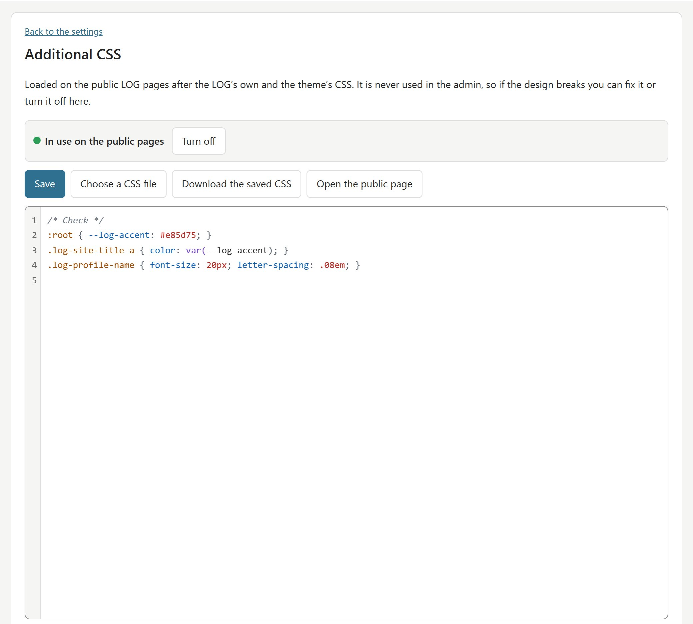

| Action | What it does |
| --- | --- |
| Input | Type directly, drag and drop a .css file, or read one with "Choose a CSS file". On phones, use the file choice. A file replaces the text being edited; with unsaved edits you are asked first |
| Limit | 256 KiB of UTF-8. A file is checked before it is read, and the saved text again on the server |
| Editor | Line numbers and colors. About 0.3 seconds after you stop typing, the syntax is checked; pressing an error or warning in the list moves to its place. Tab indents (press Esc first to move to the next field). Ctrl+S (⌘S on a Mac) saves too |
| Save | "Save" puts it on the public pages. If saving fails, your text stays on the screen |
| On and off | "Turn off" takes it off the public pages and keeps the saved text |
| Per list layout | Ticking "ミニブログのとき" (with the mini blog) and "タイルのとき" (with tiles) chooses, for each List layout setting, whether the CSS is loaded. With an unticked layout it is loaded on no page (lists, posts and fixed pages alike). Both are on at first |
| Download and restore | Download the saved CSS as a .css file. "Go back to the earlier save" swaps in the text saved before |

The additional CSS is never used in the admin. If the public design breaks, you can still fix it or turn it off from the editor page.

> [!IMPORTANT]
> With a syntax error nothing is saved, and the CSS in use stays.

### The syntax check

| Kind | What | Saving |
| --- | --- | --- |
| Error | An unclosed comment, string, url() or bracket, a closing bracket without a partner, a "{" without a selector, a declaration without ":", a declaration outside any rule, a selector without "{ }" | Refused (line, column and reason shown) |
| Warning | A property, value, selector or at-rule the open browser does not know, @import after other rules, addresses on other sites | Allowed |

The editor page and the server judge errors by the same rules.
Warnings use the browser's `CSS.supports()`. New CSS, CSS variables and browser prefixes (`-webkit-` and so on) may work in other browsers even when this one does not know them, so they are not refused.
Some elements appear only on some pages (under posts, on fixed pages, only while logged in…), so the editor never says a selector does not exist.

### How it applies

- It loads on the public LOG pages (lists, posts, fixed pages, search, archives) after the LOG's own CSS (`viewer/log.css`) and the image viewer's CSS. The manga reader's CSS loads later but is placed before the additional CSS.
- With the same specificity the additional CSS wins. Where the LOG's own CSS uses a more specific selector or `!important`, yours may not take effect; then make your selector more specific (e.g. `.log-site .log-post`).
- Overriding the CSS variables (`--log-accent` and so on) changes the theme colors at once. For one theme only, write `html[data-log-theme="dark-navy"]` and so on.
- Relative paths in `url()` start from the top of the LOG (the folder with `log.php`), e.g. `url(viewer/og.jpg)`. Pictures on the LOG can be used with their `./?media=…` address.
- The public pages' CSP (Content-Security-Policy) is not loosened for the additional CSS. Pictures load from this site and `data:`; fonts and `@import` only from this site. Pictures, fonts and CSS from other sites are not loaded.
- The CSS is served as `text/css` from `./?css=<hash of the text>` and kept by browsers for a year. Changing the text changes the address, so no old CSS lingers. With LiteSpeed Cache, the cached pages are dropped on every save, on/off switch and restore.
- It is not used on the 404 page, NagiManga's work pages (`read.php`) or viewers embedded on other sites.

### Storage and updates

The additional CSS is stored in `data/log/custom-css/`, apart from the LOG's own CSS.
The text in use and the one before it are kept as `.css` files named by the hash of their text, and `state.php` says which one is used. The name of an uploaded file is never used.
The new text is written completely before `state.php` switches to it, so a failure on the way leaves the last good CSS in place.
`data/` stays closed to the web; only the `./?css=` handler serves the CSS. The saved text never runs as PHP.
Saving uses the same login, guest refusal, CSRF protection and locks as the other settings. When another tab or device saved first, you choose which text to keep.

Updates (the automatic update in the admin, undoing an update, and uploading over the files with FTP) do not touch `data/`, so the additional CSS does not change.
The release ZIP contains no user CSS and nothing that would overwrite where it is stored. Updating never fixes or resets the additional CSS by itself.
The LOG backup ZIP includes the additional CSS and whether it is on. Restoring with overwrite brings them back; restoring without overwrite adds them only when no additional CSS was ever saved. Old ZIPs without additional CSS keep the current one.

### Classes and elements for customizing

Below the editor is the list of public selectors and CSS variables for customizing, with their use, the screens, an example and the version that added them. It can be filtered.
Internal and state names are in a folded list of their own. They may change without notice and are not meant for customizing.
"Initial list" (初期一覧) means names that existed in v0.6.0; earlier additions are not dated.
The changes by version (added, changed, deprecated, renamed, removed) are shown together, including the versions in between, after choosing the version to compare from.

The list of this version:

<details open>
<summary>Public selectors and CSS variables</summary>

<!-- css-catalog:begin (generated by manga/dev/css_catalog_check.py --write-docs) -->

**Public selectors**

| Name | Use | Screens | Example | Added |
| --- | --- | --- | --- | --- |
| `html[data-log-theme]` | The theme in use; the value is its name (light-blue, dark-navy and so on) | All pages | `html[data-log-theme="dark-navy"] { --log-accent: #7dd3fc; }` | Initial list |
| `.log-site` | The body of every public page | All pages | `.log-site { letter-spacing: .02em; }` | Initial list |
| `.log-site-header` | The header with the site name, logo and description | All pages | `.log-site-header { padding-block: 32px; }` | Initial list |
| `.log-site-title` | The site name (h1 on lists, p on a post) | All pages | `.log-site-title a { color: var(--log-accent); }` | Initial list |
| `.log-site-logo` | The title logo image | All pages | `.log-site-logo { max-height: 56px; }` | Initial list |
| `.log-site-avatar` | The icon beside the site name | All pages | `.log-site-avatar { border-radius: 12px; }` | Initial list |
| `.log-site-description` | The description under the site name | All pages | `.log-site-description { font-size: 13px; }` | Initial list |
| `.log-topmenu` | The top menu | All pages | `.log-topmenu { border-bottom: 1px solid var(--log-line); }` | Initial list |
| `.log-menu-toggle` | The MENU button on phones | All pages | `.log-menu-toggle { background: var(--log-accent); }` | Initial list |
| `.log-site-grid` | The grid holding the main column and the sidebar | All pages | `.log-site-grid { max-width: 1200px; }` | Initial list |
| `.log-site-main` | The main column (lists, posts, fixed pages) | All pages | `.log-site-main { gap: 32px; }` | Initial list |
| `.log-breadcrumb` | The breadcrumb trail | Post lists, Post pages, Fixed pages | `.log-breadcrumb { font-size: 12px; }` | Initial list |
| `.log-archive-head` | The heading row of a category, tag, date or search list | Post lists | `.log-archive-head { margin-bottom: 24px; }` | Initial list |
| `.log-archive-title` | The title in that row | Post lists | `.log-archive-title { font-size: 22px; }` | Initial list |
| `.log-post` | One post (mini blog lists and the post page) | Post lists, Post pages | `.log-post { border-radius: 4px; }` | Initial list |
| `.log-post.is-pinned` | A pinned post | Post lists | `.log-post.is-pinned { outline: 2px solid var(--log-accent); }` | v0.7.0 |
| `.log-post-meta` | The row with the icon, name and date of a post | Post lists, Post pages | `.log-post-meta time { font-weight: 700; }` | Initial list |
| `.log-pin-badge` | The pinned mark | Post lists | `.log-pin-badge { color: var(--log-accent); }` | v0.7.0 |
| `.log-body` | The text of a post | Post lists, Post pages | `.log-body { line-height: 2; }` | Initial list |
| `.log-figure` | One picture in a post | Post lists, Post pages | `.log-figure img { border-radius: 0; }` | Initial list |
| `.log-gallery` | A row of pictures posted together | Post lists, Post pages | `.log-gallery { gap: 2px; }` | Initial list |
| `.log-categories` | The categories under a post | Post lists, Post pages | `.log-categories { font-size: 12px; }` | Initial list |
| `.log-share` | The share and like row under a post | Post lists, Post pages | `.log-share { justify-content: flex-end; }` | Initial list |
| `.log-like` | The like button | Post lists, Post pages | `.log-like { color: #e0245e; }` | Initial list |
| `.log-lock-form` | The password form of a locked post or page | Post pages, Fixed pages | `.log-lock-form { max-width: 420px; }` | v0.7.0 |
| `.log-tiles` | The tile list | Tile lists | `.log-tiles { gap: 8px; }` | Initial list |
| `.log-tile` | One tile | Tile lists | `.log-tile { border-radius: 0; }` | Initial list |
| `.log-tile-title` | The title on a tile | Tile lists | `.log-tile-title { font-size: 13px; }` | Initial list |
| `.log-page` | The article of a fixed page | Fixed pages | `.log-page h1 { text-align: center; }` | Initial list |
| `.log-page-body` | The text of a fixed page | Fixed pages | `.log-page-body { line-height: 1.9; }` | Initial list |
| `.log-layout-wide` | A fixed page with the wide layout (on body) | Fixed pages | `.log-layout-wide .log-page { max-width: none; }` | Initial list |
| `.log-layout-narrow` | A fixed page with the narrow layout (on body) | Fixed pages | `.log-layout-narrow .log-page { max-width: 640px; }` | Initial list |
| `.log-md-table` | A table on a fixed page | Fixed pages | `.log-md-table th { background: var(--log-field); }` | Initial list |
| `.log-pager` | The page navigation of a list | Post lists | `.log-pager { margin-top: 40px; }` | Initial list |
| `.log-post-nav` | Links to the previous and next post | Post pages | `.log-post-nav { gap: 8px; }` | Initial list |
| `.log-related` | Related posts under a post | Post pages | `.log-related h2 { font-size: 16px; }` | Initial list |
| `.log-empty` | The text shown when a list is empty | Post lists | `.log-empty { text-align: center; }` | Initial list |
| `.log-sidebar` | The sidebar | Sidebar | `.log-sidebar { font-size: 14px; }` | Initial list |
| `.log-sidebar-block` | Each sidebar block; data-sidebar-id picks one (e.g. [data-sidebar-id="calendar"]) | Sidebar | `.log-sidebar-block[data-sidebar-id="calendar"] { display: none; }` | Initial list |
| `.log-widget` | A framed sidebar block | Sidebar | `.log-widget { box-shadow: none; }` | Initial list |
| `.log-profile-links` | The profile and links | Sidebar | `.log-profile-links { padding-top: 0; }` | Initial list |
| `.log-profile-icon` | The profile icon | Sidebar | `.log-profile-icon img { border-radius: 16px; }` | Initial list |
| `.log-profile-name` | The name under the profile icon | Sidebar | `.log-profile-name { font-size: 18px; }` | v0.7.0 |
| `.log-profile-message` | The message balloon above the links | Sidebar | `.log-profile-message { text-align: left; }` | Initial list |
| `.log-link-buttons` | The list of link buttons | Sidebar | `.log-link-buttons { gap: 6px; }` | Initial list |
| `.log-link-button` | One link button | Sidebar | `.log-link-button { border-radius: 999px; }` | Initial list |
| `.log-search` | The search box in the sidebar | Sidebar | `.log-search input { border-radius: 999px; }` | Initial list |
| `.log-calendar` | The calendar | Sidebar | `.log-calendar td { font-size: 12px; }` | Initial list |
| `.log-tag-cloud` | The hashtag list | Sidebar | `.log-tag-cloud a { font-size: 12px; }` | Initial list |
| `.log-custom-block` | An HTML box you added to the sidebar | Sidebar | `.log-custom-block { text-align: center; }` | Initial list |
| `.log-site-footer` | The site footer | Footer | `.log-site-footer { padding-block: 40px; }` | Initial list |
| `.log-footer-nav` | The footer links | Footer | `.log-footer-nav a { color: inherit; }` | Initial list |
| `.log-footer-text` | The footer text | Footer | `.log-footer-text { font-size: 11px; }` | Initial list |
| `.log-toc` | The table of contents of an article or page (four or more headings, above the first level-2 heading) | Post pages, Fixed pages | `.log-toc { background: var(--log-card); }` | v0.8.0 |
| `.log-toc-list` | The list of entries in the table of contents (.log-toc-2 to 4 follow the heading level) | Post pages, Fixed pages | `.log-toc-list .log-toc-3 { padding-left: 2em; }` | v0.8.0 |
| `.log-toc-rail` | The table of contents that follows beside the article (wide screens) | Post pages, Fixed pages | `.log-toc-rail-card { border-radius: 12px; }` | v0.8.0 |
| `.log-toc-fab` | The table of contents button (bottom right on narrower screens; its ring shows how much is read) | Post pages, Fixed pages | `.log-toc-fab { color: var(--log-cyan); }` | v0.8.0 |
| `.log-toc-sheet` | The sheet the table of contents button opens | Post pages, Fixed pages | `.log-toc-sheet { border-radius: 16px 16px 0 0; }` | v0.8.0 |
| `.log-code-block` | The frame of a code block in an article or page; holds pre.log-md-code and the COPY button | Post pages, Fixed pages | `.log-code-block pre { font-size: 13px; }` | v0.8.2 |
| `.log-code-copy` | The COPY button on the top right corner of a code block (.is-copied after copying) | Post pages, Fixed pages | `.log-code-copy { color: var(--log-accent); }` | v0.8.2 |
| `.markdown-alert` | An alert box (> [!NOTE] and the rest, with GitHub's class names) | Post pages, Fixed pages | `.markdown-alert { border-radius: 4px; }` | v0.11.0 |
| `.markdown-alert-note` | The NOTE box | Post pages, Fixed pages | `.markdown-alert-note { --alert: #0969da; }` | v0.11.0 |
| `.markdown-alert-tip` | The TIP box | Post pages, Fixed pages | `.markdown-alert-tip { --alert: #1a7f37; }` | v0.11.0 |
| `.markdown-alert-important` | The IMPORTANT box | Post pages, Fixed pages | `.markdown-alert-important { --alert: #8250df; }` | v0.11.0 |
| `.markdown-alert-warning` | The WARNING box | Post pages, Fixed pages | `.markdown-alert-warning { --alert: #9a6700; }` | v0.11.0 |
| `.markdown-alert-caution` | The CAUTION box | Post pages, Fixed pages | `.markdown-alert-caution { --alert: #d1242f; }` | v0.11.0 |
| `.markdown-alert-title` | The title of an alert box (its icon and name) | Post pages, Fixed pages | `.markdown-alert-title { font-size: 15px; }` | v0.11.0 |
| `.log-mermaid` | The frame of a diagram (a flowchart or sequence diagram written in ```mermaid) | Post pages, Fixed pages | `.log-mermaid { background: var(--log-bg); }` | v0.11.0 |
| `.log-mermaid-zoom` | The Enlarge button on the top right corner of a diagram | Post pages, Fixed pages | `.log-mermaid-zoom { color: var(--log-accent); }` | v0.11.0 |
| `.log-mermaid-sheet` | The diagram over the whole screen, opened by Enlarge | Post pages, Fixed pages | `.log-mermaid-sheet { background: var(--log-card); }` | v0.11.0 |
| `.log-dg` | A drawn diagram (SVG). Its colors follow --dg-edge (frames and strong arrows), --dg-line (lines), --dg-box (boxes) and --dg-ink (words) | Post pages, Fixed pages | `.log-dg { --dg-edge: #e0607e; }` | v0.11.0 |
| `.log-frame` | A page embed ([Embed]URL[/Embed]) as a whole. --frame-width sets the width of its frame | Post pages, Fixed pages | `.log-frame { --frame-width: 100%; }` | v0.11.0 |
| `.log-frame-stage` | The frame of a page embed (its cover, then the page once pressed) | Post pages, Fixed pages | `.log-frame-stage { border-radius: 0; }` | v0.11.0 |
| `.log-frame-play` | The Load the page sticker on a page embed’s cover | Post pages, Fixed pages | `.log-frame-play { transform: none; }` | v0.11.0 |
| `.log-frame-bar` | The row under a page embed (the link to open it in a new tab and the Full screen button) | Post pages, Fixed pages | `.log-frame-bar { font-size: 13px; }` | v0.11.0 |

**CSS variables**

| Name | Use | Screens | Example | Added |
| --- | --- | --- | --- | --- |
| `--log-accent` | The theme accent (buttons, links, rims) | All pages | `:root { --log-accent: #e85d75; }` | Initial list |
| `--log-bg` | The page background | All pages | `:root { --log-bg: #fffaf3; }` | Initial list |
| `--log-card` | The background of posts and boxes | All pages | `:root { --log-card: #ffffff; }` | Initial list |
| `--log-cyan` | A second color (icon letters and so on) | All pages | `:root { --log-cyan: #0e7490; }` | Initial list |
| `--log-field` | The background of fields and chips | All pages | `:root { --log-field: #f3f4f6; }` | Initial list |
| `--log-line` | Lines and borders | All pages | `:root { --log-line: #e5e7eb; }` | Initial list |
| `--log-muted` | Muted text (dates, notes) | All pages | `:root { --log-muted: #6b7280; }` | Initial list |
| `--log-on-accent` | Text on the accent color | All pages | `:root { --log-on-accent: #fff; }` | Initial list |
| `--log-radius` | The corner radius | All pages | `:root { --log-radius: 6px; }` | Initial list |
| `--log-shadow` | The shadow of posts and boxes | All pages | `:root { --log-shadow: none; }` | Initial list |
| `--log-text` | The text color | All pages | `:root { --log-text: #222; }` | Initial list |

<!-- css-catalog:end -->

</details>

The list is written by hand in `server/lib/css-catalog.json`. The admin only reads it; nothing builds or compares lists on the server or on a phone.
`dev/css_catalog_check.py` collects the names from `log.css` and the code and compares them with the list. It fails for a name in the CSS but not in the list, a listed name that no longer exists, and a public selector removed or renamed since the last release (the newest `v*` tag) without a history entry. Classes whose names are built in code are registered in `dynamic`.
GitLab CI and GitHub Actions run the same check. Before a release, replace `"next"` in the list with the version number and rewrite the README copy with `python manga/dev/css_catalog_check.py --write-docs` (`dev/build_release.py` checks this and refuses to build the ZIP otherwise). That command builds the list below from `css-catalog.json`.

## Search

The search box is in the side menu of public pages. On phones it is inside "MENU" at the top right.
It searches the text, titles, hashtags, category names and the titles of manga in the text. Only public posts; drafts are not shown.

| Input | Finds |
| --- | --- |
| `ねこ` | posts with either "ねこ" or "ネコ" (hiragana and katakana are the same) |
| `ＡＢＣ１２３` | posts with half-width `abc123` too (full-width and half-width, upper and lower case are not distinguished) |
| `ねこ 散歩` | only posts with both "ねこ" and "散歩" (up to 5 words separated by spaces) |
| `#doodle` | posts with that hashtag in the text |

Results are listed in the usual list form under a heading such as "「ねこ」の検索結果　12件" (12 results for ねこ). Paging keeps the search words.
Search result pages are kept out of search engines (`noindex`).
The side menu's search box can be reordered and hidden under "Settings → LOG → Sidebar and menu". Logs in use from before get it right below the profile and links.

"Log and posts" in the admin panel has a search box above the list too. The `/` key moves to it.
It finds drafts too, narrowed down with "all, public, drafts".
Results show part of the text with the found words in yellow, the categories, and which page of the public site's top it is on (for example "page 3 of the top"). Pressing it opens that page.

## List styles and related posts

Choose under "Settings → LOG → List style and below posts".

| Style | The list | Suits |
| --- | --- | --- |
| Microblog (default) | Posts are shown from start to end. They can be read on the list page alone. | Logs with many short notes |
| Tiles | Tiles of thumbnail, date and title in 2 columns (2 on phones too). An even number of posts per page is recommended; with an odd number the last row of each page has a gap. | Logs with longer posts, or that want to look like a WordPress blog |

A tile's thumbnail is the first one found from the top of the text.
It looks for a log picture, a manga cover (a public work without a password), a YouTube video thumbnail and a blog card's picture, in that order.
Posts with none get a panel with the first character of the title, large.
Thumbnails are noted in the list data (`log/index.php`), so tile lists are made without opening the post originals.
List files of an old version are made again once, the first time they are shown.
YouTube thumbnails are loaded by the reader's browser from `i.ytimg.com`.

**New mark**

Posts within a period after posting get a mark: at the top left of the thumbnail in tiles, at the top left of the post's frame in the microblog.
"Settings → LOG → List style and below posts → New mark" changes the period (7 days by default; 0 days for none) and the text (`NEW` by default; up to 10 characters such as "新" or "New!").
Post pages (showing one post) do not get it.
Even when the page is cached, marks whose period has passed are removed in the browser (`viewer/log-new.js`).

Related posts: six are shown under the post (above the previous and next posts).

- What counts as related: "categories and hashtags" (default), "categories only", "hashtags only"
- Order: "random" (default) and "most recently updated first"

With random, up to 18 closely related posts (2 points for the same category, 1 point per shared hashtag) are put into the page, and the browser picks six.
The page itself is the same for everyone, so LiteSpeed Cache keeps working. Without JavaScript, the six most related are shown.
Posts with no post of the same categories get no related posts box.

## Pinned posts

Like “stick to the top of the blog” in WordPress, posts can be shown first on the top page.
In the admin post list, the pin button on a row pins the post, and pressing it again unpins it. The “ピン留め” (pin) card on the post’s edit page switches it too.

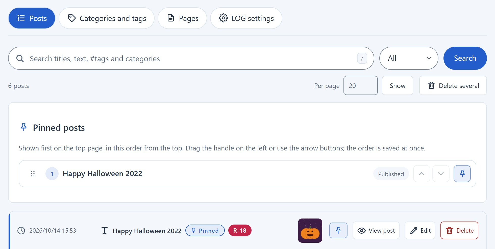

- Pin as many as you like (up to 30). Pinned posts come first on the top page, whatever their dates, in the order you choose.
- Reorder them in “ピン留め中の記事” (pinned posts) above the post list, by dragging the handle or with the arrow buttons. The order is saved at once. A newly pinned post goes to the end.
- The admin post list shows pinned posts at the top too, with a coloured line on the left and the “固定” (pinned) mark.
- On the public pages, posts (microblog) and tiles carry the “固定” mark. A pinned tile shows the pin instead of the new mark.
- Only the top page list puts them first. Category, tag and date lists, RSS, the latest posts in the sidebar and the previous and next posts stay in date order.
- A draft can be pinned too; readers see it once it is published. The pin stays when publishing gives the post a new number.
- Deleting a post unpins it. The pins and their order are included in the log backup.

## Password locks

Posts and fixed pages can be locked with a password for readers.
For a post, use the lock button in the tool row of the post box; for a fixed page, “パスワード（鍵）” (password lock) on its edit page. Turn on “lock with a password” and enter a password of 4 to 200 characters.
A locked post shows “パスワードあり” (password) in the post box and “鍵付き” (locked) in the post list. The owner (logged in) always sees the text.

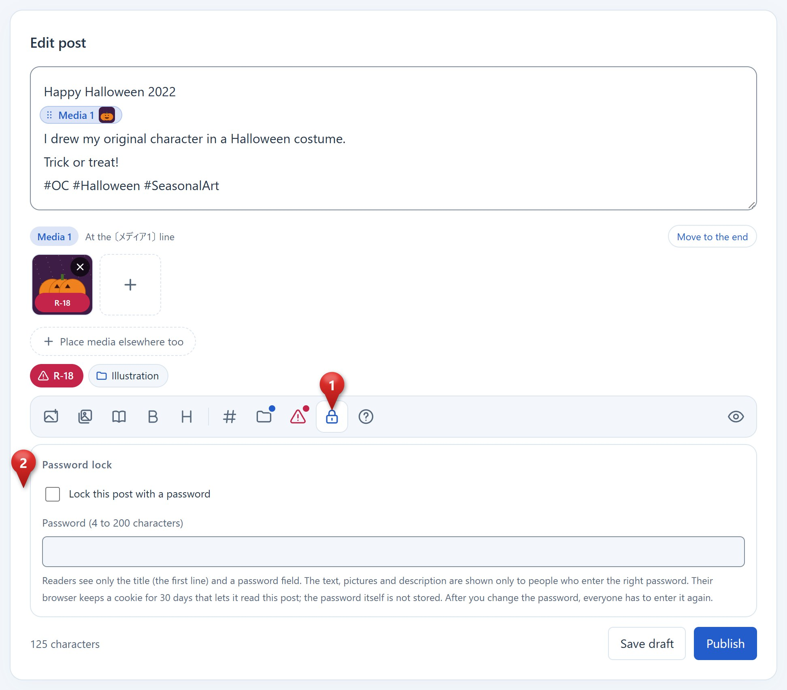

Readers see the following.

| Place | What is shown |
| --- | --- |
| A post or fixed page | The title and the password field only. No text, pictures or embeds |
| Lists (microblog) | The title and a “パスワードを入れて読む” (enter the password to read) link |
| Tiles and related posts | A lock picture instead of the thumbnail |
| Description, RSS | Only “この記事はパスワードで保護されています。” (this post is protected by a password) |
| Share card (OGP) | The first picture of the text, blurred so strongly that only its colours remain, under a lock and “鍵付き” (“Locked” when the admin language is English). The same for posts with content warnings such as R-18. Posts without pictures use the site’s common picture |
| Search | Found only by the title and category names, never by words of the text |
| Pictures | Pictures used only by locked posts are given only to readers who opened them (404 for everyone else) |
| Search engines | `noindex`, and not listed in the sitemap |

After the right password, a mark that lets the browser read that post (a signature per post) is kept in the `nl_keys` cookie for 30 days, so the password is not asked again during that time.
The cookie holds only that mark: neither the password nor its hash. Changing the password makes the marks invalid, so readers who opened it have to enter the new one.

The password field is built so that browsers and password managers do not save it.
It is not a password field (`type="password"`) but a plain field whose characters are hidden with CSS, with `autocomplete="off"` and the “ignore” hints of the main password managers.
So no “save password?” prompt appears, and nothing is kept in the input history. “入力した文字を表示” (show what I typed) reveals the characters to check them.
After sending, the reader goes back to the post page (303), so reloading never sends the password again.

Wrong answers are limited to 5 per post in 15 minutes and 30 per hour from the same address; beyond that the form refuses for about 15 minutes.
The password is stored as a hash. So that the owner can look it up on the edit page, a copy encrypted with the secret key is kept too (the same way as the manga reader password).
Locks are included in the log backup, and posts stay locked after a restore.

## Likes

On a public log, a heart like button is left of "Share" under each post. To turn it off, remove it under "Settings → LOG → List style and below posts".

| Action | Adds |
| --- | --- |
| Tap, click, Enter key | 1 |
| Hold | 10 every 70 frames (about 1.17 seconds at 60fps) while held. A colored band inside the button shows the progress to the next 10 |

Presses in a row are sent together once. Presses right before the page closes are sent too.
One person can press at most 100 per post per day (Japan time). At the limit it shows "MAX" and adds no more.
"One person" is told apart by the combination of the same line (IP address) and the same device (the device information the browser sends, the User-Agent). Family members on the same line are counted separately on different devices, such as a phone and a computer.
For IPv6, the range given to each home line (/64) is taken together.
Device information is easy to rewrite, so the same line as a whole is also limited to 500 per post per day.
IP addresses and device information themselves are not stored; only marks made with the secret key are kept, and only for that day.

Counts are stored in a small file separate from the post originals (`log/likes.php`). Likes do not rebuild posts or page caches.
When a page opens, the browser gets the latest count and that day's remaining presses from `like.php` once.
To keep forms and scripts of other sites from sending, a dedicated header and the sender are checked. More than 60 sends per minute from the same IP are refused.

The post's edit screen has a "いいね" (Likes) box. See the current count, change it to any number, or set it back to 0 with "いいねを削除" (delete likes).
Deleting a post deletes its likes too.

## Reordering the sidebar and HTML boxes

The top of the sidebar shows a borderless profile and links.
The icon chosen in the LOG settings is in the middle, with wide link buttons under it.
Without an icon, the first character of the display name is used.
The icon has a rim in the theme's color by default. Turn off "アイコンにフチを付ける" (rim the icon) to remove it.
Under the icon goes the "名前" (Name) set in "LOGのデザイン・アイコン" (LOG design and icon) in the LOG settings. Turn off "アイコンの下に名前を表示する" (Show the name under the icon) to hide it.
Above the links, a message separate from the site introduction can be shown, up to 300 characters. Line breaks work; HTML does not. Empty means not shown.
The message is a speech balloon talking up toward the icon.

"Edit the profile and links" edits the rim, the name display and the message, and each link's display name, URL and an icon for its use.
Links can be added, deleted and moved up and down.
The initial URLs are the top pages of X, Instagram, Bluesky, GitHub and YouTube.
Rewrite, for example, X's URL into your profile URL.

The SVG icons are original drawings of a conversation, a photo, sky and communication, a code branch, film, an envelope (mail) and a general link.
For mail, write only the address, such as `you@example.com`, in the "URL / mail" field and choose the "mail" icon. `mailto:` can be included too.
Visitors who press the mail button get a dialog showing the address. They choose "アドレスをコピー" (copy the address) or "メールアプリで送信" (send with the mail app, the default one).
Without JavaScript, the default mail app opens directly. Subjects (`?subject=`) and several recipients cannot be used.
No official logos or existing brand images are used.
`server/viewer/link-icons/` includes the SVGs and the full MIT license.
Existing sidebar settings and old backups get the links added too.
The order of the other items is kept. To hide the links, turn off their switch and save.

Edit it under "Settings → LOG → Sidebar and menu".
Each item is one row; move it by dragging the handle or with the up and down buttons.
Turning off a switch hides it. The phone "MENU" uses the same order.
The order and contents are applied with the other settings by "Save settings" fixed at the bottom of the screen.
Showing the login link is switched only by this "Log in / Admin page" switch. The setting that used to be under "Audience and counts" was moved here.

Open "上級者向け：HTML枠を追加" (advanced: add an HTML box), choose a template and add it.
There is no fixed number of boxes. The same template can be called again and again.
Grid links are two columns of links; banner links are picture links without a frame or background.
After adding, rewrite the link targets, picture URLs and text with your own.
An empty heading hides the heading. "枠と背景を表示する" (show the frame and background) can be changed too.

HTML boxes can use links, pictures, headings, paragraphs, lists and bold.
script, iframe, forms, event attributes and style attributes are removed when saving.
The layout classes `log-link-grid`, `log-banner-link` and `log-banner` can be used.
Headings up to 100 characters, one box's HTML up to 50KB after cleaning, all together up to 1MB.
If another screen saved first, it does not overwrite; your changes stay in the edit field and it tells you to open the screen again.
Copy unsaved HTML somewhere before reopening the screen.

Picture URLs are relative URLs to the same site or HTTPS URLs.
Outside pictures are fetched from the outside server when shown, so the visitor's IP and so on reach that server.
Pictures placed on the same site avoid this outside traffic.
Log pictures referred to by HTML boxes remain even if the original post is deleted.
On a public log, log pictures referred to by shown HTML boxes are public too.
Pictures used by hidden boxes are protected from deletion, but not published just because of that box.
In a private Memo, the sidebar and its log pictures are also shown only when logged in.

Removing an HTML box and saving does not delete the link targets or the pictures themselves.
Log pictures no longer used can be deleted from "Media list and replace".

## Title logo and introduction

Choose a picture as the "タイトルロゴ" (title logo) under "Settings → LOG → Log design and icon", and the logo is shown instead of the icon and site name at the top of the page. A wide banner (for example 200×40px) suits it, and SVG works. Its height is reduced to at most 64px on computers and 44px on phones. "ロゴを外して、アイコンとサイト名に戻す" (remove the logo and go back to the icon and site name) undoes it.

The site name (logo) is the `h1` heading on list pages such as the top, categories and tags.

```html
<h1 class="log-site-title has-logo">
  <a href="./">
    
  </a>
</h1>
```

The logo's `alt` holds the site name. On post pages and fixed pages, the post's or page's title is the `h1`, so the site name is a `p`, keeping one `h1` per page (the earlier invisible `h1` is no longer output).

Turning off "紹介文をサイト名の下に表示する" (show the introduction under the site name) keeps the introduction off the screen and uses it only as the description in search results and when shared (`meta description`, `og:description`).

## Favicon and home screen icons

Choose one picture in “ファビコン・ホーム画面のアイコン” (favicon and home screen icons) under Settings → LOG → LOG design and icon, and these icons are made automatically. A square 512 × 512 px PNG is recommended.

| Made | Size | Used by |
| --- | --- | --- |
| `favicon.ico` | 16, 32 and 48 px (an ICO holding three PNGs) | Browser tabs, bookmarks |
| iPhone icon | 180 px | “Add to Home Screen” on iPhone and iPad |
| Android icons | 192 px and 512 px | “Add to Home screen” on Android, the web app manifest |

- Pictures are scaled down by halves, step by step (512 → 256 → 128 → 64 → 32 → 16). Thin lines and letters survive better than with one big jump.
- Everything is saved as lossless PNG; no lossy compression such as JPEG or WebP.
- A picture that is not square gets a transparent margin instead of being cropped.
- iPhone paints transparent parts black, so only the iPhone icon gets the design’s background colour behind it. Changing the design colour remakes it.
- Sizes larger than the picture are not made, since enlarging would blur them. With a picture under 512 px, the settings screen tells which sizes were skipped. Pictures under 48 px and SVG cannot be used.
- The settings screen shows each made size at its real size. The admin panel’s tab uses the same favicon.
- The files are served as `./?favicon=…&v=VERSION`, and browsers keep the versioned URLs for a year. A new picture gets a new version.
- Without one, the icon picture is scaled down as before. “ファビコンを外して、アイコンの画像に戻す” (remove the favicon) goes back to that.
- The favicon picture is not included in the log backup; choose it again after moving.

## Top menu

"Settings → LOG → Top menu" makes the links lined up under the site name. With no items, nothing is shown.

- "Add item" adds a row; enter the display name and the link target. Up to 30 items, display names up to 40 characters.
- Typing part of the name of a fixed page, category or hashtag in the display name shows suggestions (hiragana and katakana, full-width and half-width are not distinguished). Choosing one fills in the display name and the target (a URL inside the site such as `./privacy` or `./?category=…`). Links entered earlier as `./?pg=privacy` keep working. "ホーム（すべての投稿）" (home, all posts) is a suggestion too.
- Outside sites are entered from `https://`. URLs such as `javascript:` are not saved.
- Reordering works as in the sidebar: drag the handle on the left or use the arrow buttons. Turning off the switch hides an item without deleting it.
- Save with "Save settings" at the bottom of the screen.

Typing a display name shows category and hashtag suggestions. In the example below, "イラスト" (illustration) is typed. Choosing a suggestion fills in the target too, and the changed block gets a mark at its left edge and in the contents. The names of unsaved items are shown at the bottom of the screen.

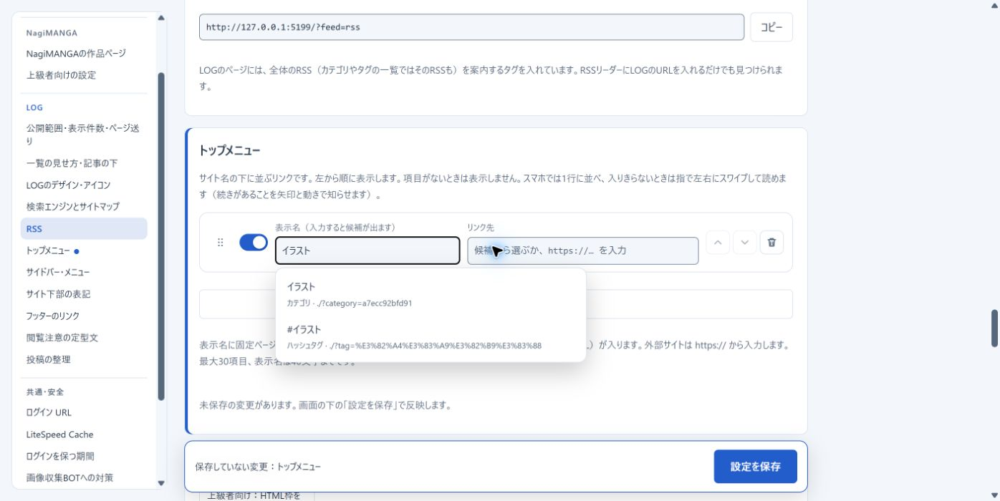

On public pages, the item of the current page (fixed page, category, tag, top) gets an underline and `aria-current="page"`. Links to outside sites get `rel="noopener noreferrer"`.

On phones they are lined up in one row like the tabs of Bluesky and X, and what does not fit is read by swiping sideways. To make it clear that there is more:

- The edges fade into the background color, and a round arrow appears on the side where there is more. Pressing the arrow moves in that direction.
- When first shown, the menu moves a little to the left once and comes back (showing that it scrolls).
- Until you swipe, the right arrow keeps wiggling slightly. Once moved, it stops.
- When the item of the current page is out of view, it scrolls so that the item is in the middle before showing.
- On computers it looks the same when it does not fit, and the mouse wheel moves it sideways.
- Devices with "reduce motion" (`prefers-reduced-motion`) get no motion.

## Fixed pages

Pages outside the flow of dates, such as a privacy policy, terms of use or a profile. Make them in the "固定ページ" (Fixed pages) tab of Log and posts (`admin/index.php?p=log_pages`).

| Item | Details |
| --- | --- |
| Title | One line of up to 100 characters. It becomes the page's `h1` and `<title>` |
| URL name | Up to 40 half-width lowercase letters, digits and hyphens. The public URL is `./URLNAME` (for example `./privacy`; `./?pg=privacy` on servers that do not apply `.htaccess`). Empty gets one automatically. Folder names of the LOG such as `admin` cannot be used |
| Password lock | With “このページにパスワードをかける” (lock this page with a password) on, readers see only the title and a password field ([Password locks](#password-locks)) |
| Page width (computer) | With the sidebar (normal) / wide single column (no sidebar, full width) / narrow single column (no sidebar, only the text column, centered) |
| Text | Markdown up to 200KB. A field separate from post text |
| Public or draft | Drafts give 404 to readers and are shown only when logged in |

On phones the sidebar is inside "MENU" anyway, so the width choice makes no difference.
Changing the URL name after publishing makes the old URL 404. Avoid changing it after publishing, so that links keep working.

The Markdown that can be used in the text is below. Line breaks stay line breaks, and a blank line starts a new paragraph. HTML tags are shown as text and do not run on the page.

| Syntax | Shown as |
| --- | --- |
| `## Heading` (`#` too) / `### Subheading` / `#### Smaller` | Headings (h2 / h3 / h4). Headings get an ID for jumping with `#heading text`. With four or more, a table of contents goes right above the first heading 2 |
| `**bold**` `*italic*` `~~strikethrough~~` `` `code` `` | Emphasis |
| `\|親文字《おやもじ》` / `漢字《かんじ》` | Ruby (readings; see [Ruby (reading aids)](#ruby-reading-aids)) |
| `- item` / `1. item` (two spaces at the start of the line to nest) | Bulleted and numbered lists |
| `[text](https://…)` / `[text](./?pg=terms)` / `[mail](mailto:…)` | Links. `javascript:` and the like do not become links |
| `` | Pictures. Log pictures can be zoomed with NagiSwipe, and replacing them shows the new picture |
| `> quote` | Quotes |
| `> [!NOTE]`, then `> text` on the next lines | An alert box (TIP, IMPORTANT, WARNING and CAUTION too; see [Alerts and diagrams](#alerts-and-diagrams-mermaid)) |
| `\| item \| details \|` followed by a line `\| --- \| :-: \|` | Tables (`:-:` centers, `--:` aligns right) |
| `---` | A dividing line |
| enclosed in ```` ``` ```` | Code over several lines |
| enclosed in ```` ```mermaid ```` | A diagram (flowchart or sequence diagram; see [Alerts and diagrams](#alerts-and-diagrams-mermaid)) |
| `[Embed]URL[/Embed]` | Another page (a game, say) in a frame (see [Page embeds](#page-embeds)) |

The edit screen's tool row has the same icons as the posting box: "画像を追加" (add pictures), "画像一覧から選ぶ" (choose from the picture list), bold, italic, links, "装飾" (Format, the same window as in the posting box) for headings, bullets, numbers, quotes, tables, dividing lines, strikethrough, code and ruby, "Markdownの書き方" (?, the Markdown table), and the preview (the eye) at the right end.
It is laid out like the posting box too. On a PC or a phone turned sideways the tool row sits above the text, and the text box has "書く" (Write) and "プレビュー" (Preview) tabs; the preview keeps the text box's height and scrolls inside. A media dock on the left has "このページ" (this page: the pictures in the text, with a count) and "画像一覧" (the picture list: search by description, choose, and it goes in at the cursor). "本文へ" (back to the text) beside the heading leaves the preview or the list. "下書き保存" and "公開して保存" stay at the bottom of the screen.
On a phone held upright the tool row is right under the text. The eye opens the preview over the whole screen at the size readers see, with "閉じて編集に戻る" (close and keep writing) at the bottom (Escape closes it too). "画像一覧から選ぶ" opens the picture list in a small screen.
Pictures can also be added by dropping them anywhere on the edit screen or pasting them into the text, which puts in a `` line.
The pictures in the text are lined up as thumbnails, as in the posting screen (under the text on a phone, in the dock's "このページ" on a PC). Pressing one selects its line in the text, and × removes it from the text (the picture itself stays in the picture list). The "+" at the end of the row and the picture button also add pictures. Saving goes over the network, and when it fails the text you wrote stays on screen. It does not save with a duplicate URL name or when the page was updated on another screen.

The example below has a picture in the text of a profile, with the preview open. Title, URL name and page width are set at the top, and the row of pictures and the preview are checked under the text. "下書き保存" (save draft) does not publish it to readers; "公開して保存" (publish and save) does.

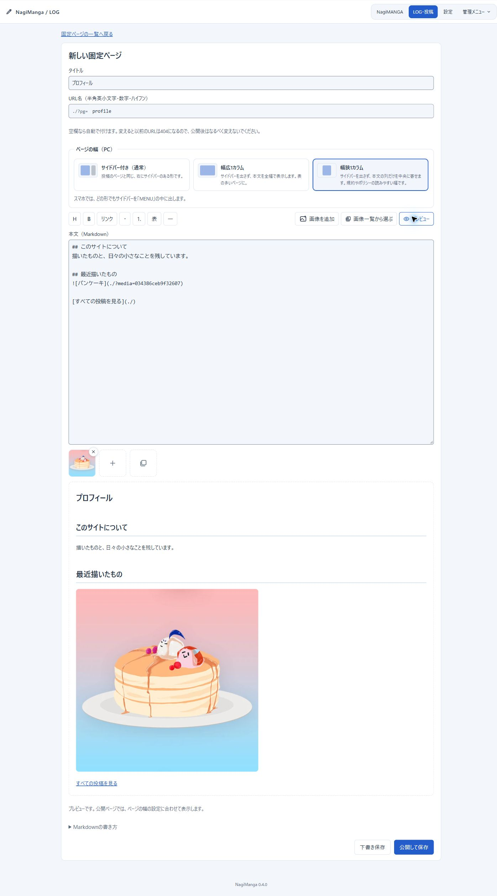

The description (`meta description`) of a fixed page is made from the start of the text without Markdown marks. Public fixed pages are in the sitemap (priority 0.5), and `index,follow` when search engines are allowed. The breadcrumbs are "HOME › title". They are suggestions in the top menu too. Pictures used by fixed pages cannot be deleted in the picture list.

### Top page and blog

Like the “Your homepage displays” setting of WordPress, the top of the site can show a fixed page, and the post list moves to its own URL as the blog.
Turn it on or off under “トップページとブログ” (Top page and blog) in the LOG tab of the settings. It starts off: the top page lists the posts as before.

With NagiLog at the root of a domain (`https://example.com/`):

| Page | Off (default) | On |
| --- | --- | --- |
| Top | `https://example.com/` (the post list) | `https://example.com/` (the chosen fixed page) |
| Post list | `https://example.com/` | `https://example.com/blog` |
| Categories, tags, dates, search, later pages | `https://example.com/?category=…` | `https://example.com/blog?category=…` |
| Posts and other fixed pages | `https://example.com/20261004123033` / `https://example.com/privacy` | Unchanged |

| Item | Details |
| --- | --- |
| Page shown on the top page | One of the fixed pages. It is shown at the top URL instead of its own (`./about` and so on); its own URL moves to the top with a 301. While it is a draft, visitors who open the top are taken to the blog (logged in, you still see the draft) |
| URL name of the blog | `blog` by default. Up to 40 half-width lowercase letters, digits and hyphens. The URL name of a fixed page and folder names of the LOG such as `admin` cannot be used. On servers that do not apply `.htaccess` it is `./?pg=blog` |
| Blog label | The name in the menus and the breadcrumbs. Left blank, it is “ブログ” (Blog on English screens) |
| Links to the blog | “First in the top menu” and “In the footer links (after HOME)”, both on by default. They follow the URL name and the label when you change them |

The blog URL is `./blog`, at the same depth as fixed pages. `./blog/` with a trailing slash moves to `./blog` with a 301 (the LOG's links and pictures are relative URLs, so the blog must not look like a folder).
Turning it on moves the earlier `./?category=…` and `./?page=2` to the same list in the blog with a 301. Turning it off moves `./blog?…` back to the list at the top, so links you have shared keep working either way.

The breadcrumbs are “HOME › Blog” on the blog, “HOME › Blog › category” on a category and “HOME › Blog › category › post title” on a post. The top page shows no breadcrumbs, and its `<title>` is only the site name.
The sitemap lists the top (priority 1.0), the blog (0.8) and the categories (`./blog?category=…`); the fixed page used as the top is not listed under its own URL. The RSS `<link>` is the blog URL too.
“Blog (all posts)” is also a suggestion in the top menu and footer link editors. To place the link elsewhere, clear the box above, add an item, type Blog as its label and pick it from the suggestions. Fix links added this way by hand if you change the URL name later.
The settings are part of the LOG backup.

## SEO and OGP

Which pages go into search engines depends on the list style.
"Settings → LOG → Search engines and sitemap" shows a table of what the current settings give.

**Tiles**

| Page | For search engines |
| --- | --- |
| Top and categories (page 2 and on too) | `index,follow` |
| Single posts | `index,follow` |
| Hashtags, dates, months, search results | `noindex,follow` |
| Lists without posts | `noindex,follow` |

Tile lists hold no post contents, so single posts are the entrances from search.
Page 2 and on are listed too, each with its own URL as the canonical URL, so that search engines keep following links to older posts.
Hashtags are many and overlap with categories, so they are not listed. Date and month lists and search results only rearrange the same posts, so they are not listed either.

**Microblog (default)**

| Page | For search engines |
| --- | --- |
| Page 1 of the top and categories, public and with posts | `index,follow` |
| Single posts, hashtags, dates, months, search results, page 2 and on | `noindex,follow` |
| Lists without posts | `noindex,follow` |

The microblog shows whole posts in its lists, so the top and categories are the entrances from search.
With single posts noindex, visits from search to those posts themselves cannot be had.
canonical alone can merge duplicates, so noindex on single posts is not a must.

**Common**

| Page | For search engines |
| --- | --- |
| Every page of a private Memo | `noindex,follow`. 404 for visitors who are not logged in |
| R-18 posts | `noindex,follow`, and not in the sitemap |
| Login, admin panel, 404 | `noindex,nofollow` |
| RSS | `noindex` (it is for RSS readers) |

For details, see Google's [explanation of noindex](https://developers.google.com/search/docs/crawling-indexing/block-indexing) and
[explanation of canonical URLs](https://developers.google.com/search/docs/crawling-indexing/consolidate-duplicate-urls).

### Breadcrumbs

Except on page 1 of the top, breadcrumbs are shown above the text. They start with a house icon and "HOME" and end with the current page.

| Page | Breadcrumbs |
| --- | --- |
| Post | HOME › first category › post title (HOME › post for posts without a category) |
| Category, hashtag, search results | HOME › category name, #tag name, results for "words" |
| Date, month | HOME › October 2026 › October 4 |
| Page 2 and on | "page 2" after the above |

The first text is chosen under "Settings → LOG → List style and below posts → Start of the breadcrumbs": `HOME` (default), the site name, or any text (up to 30 characters; empty means `HOME`).

The same hierarchy is also output as schema.org `BreadcrumbList` (JSON-LD). Search engines understand where the page sits, and search results may show the hierarchy instead of the URL.
The icon and separators are drawn in SVG. Long names are cut with "…", favoring the name of the current page.

### Keeping it out of search engines

For fan-work sites, or sites that do not want to be mistaken for official ones, "すべてのページを載せない（noindex,nofollow）" (keep every page out) can be chosen.
It tells every page (both in the headers and in `<meta>`) and the log pictures "do not list, do not follow links", and stops the sitemap (404).
Pages already listed disappear when the search engine next reads them. Only search engines that follow the rules obey.
robots.txt is not used to block everything: blocking with robots.txt stops search engines from reading noindex, and only the URL may stay in results.

### Sitemap

`https://your-installation/?sitemap=xml` gives a sitemap of only the pages that go into search.
Copy the URL under "Settings → LOG → Search engines and sitemap" and register it with Google Search Console or Bing Webmaster Tools.

| Pages listed | priority | lastmod |
| --- | --- | --- |
| Top | 1.0 | the time of the last updated post or setting |
| Single posts (only with tiles) | 0.7 | when the post was updated |
| Categories with posts | 0.5 | when the category's last post was updated |

Page 2 and on are not listed, as they can be reached from each page's links.
Google says it does not use priority and looks at accurate lastmod values. lastmod holds the real update time.
With the log in a subfolder, robots.txt at the domain's root cannot be written automatically. Register the sitemap from the search engine's own tools.
Without changes it returns `304 Not Modified`, so repeated visits cost the server little.

### RSS

`https://your-installation/?feed=rss` gives RSS 2.0 of the 20 newest posts.
For one category, `?feed=rss&category=CATEGORY_ID`; for one hashtag, `?feed=rss&tag=TAGNAME`.
Choose the range under "Settings → LOG → RSS" to make the URL, and copy it with "コピー" (Copy).
It sends the title, URL, date, category names and description. The full text is not sent.
Log pages have a tag announcing where the RSS is. Category and hashtag lists also announce the RSS of that range.
A private Memo has no RSS.

### Descriptions

A single post's description is made automatically from its text (from the second line).
Picture and manga tags, URLs (embeds, blog cards, links), hashtags and bold marks are left out, and up to 120 characters of text alone are used.
Posts without text use the site introduction. RSS descriptions are the same. The title is the first line, as before.

OGP is the information on the card shown when a URL is shared on social media and the like.
A single post uses the first picture without a content warning, from the start of the text (SVG is not used).
A post with only one sensitive picture uses another picture for the card.
Reordering picture tags changes the picture chosen too.
The OGP of posts without pictures is the common OGP picture you set; if not set, the included common picture.
Posts with only manga use this common picture too.

Posts with only marked pictures, and posts marked sensitive, R-18 or R-18G as a whole, get a card picture (1200×630 WebP) made on the server.
The first marked picture of the text is blurred and darkened until its shapes cannot be told, and a glass-like card in the middle shows the level's name (センシティブ / R-18 / R-18G), the note and "閲覧注意" (content warning).
The URL is `./?ogimage=POST_NUMBER&v=…`, made when a social service first reads it and stored and reused in `data/log/og/`. Replacing the picture or changing the level gives a new picture at a different URL, and the old one is deleted. Deleting the post deletes it too. Servers that cannot write WebP make JPEG.

The level names are drawings made in SVG beforehand and included as transparent PNG (`viewer/og-veil/`). The server only lays them over the picture blurred with GD, so no fonts or FreeType are needed. The letters are drawn in the open-source font M PLUS Rounded 1c (SIL Open Font License) (`viewer/og-veil/LICENSE-font.txt`). To change the design, run `manga/dev/build_og_veil.py`, which fetches the font and makes the PNGs again from the SVGs.
On a public log, posts kept out of search still have share cards.
A private Memo does not hand text or log pictures to outside services, so OGP cards are not available.

## Measures against image-scraping bots

"Common and security → Measures against image-scraping bots" in the settings adjusts the names of scraping tools and the fetch limits.
By default, User-Agents that indicate image-scraping tools and mass fetching from the same IP are refused with 404.
It applies to log pictures and manga pictures alike. It is not a setting that refuses reading text or AI across the board.

The default limits are 120 per 10-second window and 300 per 1-minute window.
IPs over the limit are refused pictures for 5 minutes.
People on the same line, and reading manga with many pictures, count too.
If it affects legitimate reading, adjust the limits or the tool names.

Bots disguising their User-Agent as a normal browser and fetching little by little, or spreading over IPs, cannot be fully told apart.
It is not a mechanism that prevents every saving of published pictures either.
Set up measures against large-scale fetching on the server or CDN side too if needed.

## Protecting the storage

The storage is `data/`, shared with NagiManga.
Moving it outside the public folder is recommended. For example, move it to
`/home/you/nagimanga-data` on the server and make `lib/paths.php` with:

```php
<?php return '/home/you/nagimanga-data';
```

Make sure PHP can write there.
If it stays inside the public folder, deny HTTP access to `data/` with `.htaccess` or similar.
Where `.htaccess` cannot be used, as on nginx, move the storage outside or deny access in the server settings.

The log's internal records are PHP files that give 404 when opened directly, but picture files have no PHP processing.

> [!CAUTION]
> If the storage can be reached over HTTP, knowing a picture's real path gets around authentication and the bot measures.
> Storage folder names made from the secret key are no substitute for encryption.
> Check the warning in the admin panel, and that direct access from outside is denied, before publishing.
> Detailed server examples are in [NagiManga's installation guide](README.en.md#protecting-the-data-folder).

## Storage layout and backup

| Item | Place in `data/` |
| --- | --- |
| Originals of published posts | `log/posts/YEAR/POST_NUMBER.php` |
| Drafts before first publication | `log/posts/drafts/TEMP_NUMBER.php` |
| List data | `log/index.php` |
| Categories | `log/taxonomy.php` |
| Log display settings | `log/settings.php` |
| Sidebar order, display, links, HTML boxes | `log/sidebar.php` |
| Top menu | `log/topmenu.php` |
| Footer links | `log/footmenu.php` |
| Fixed pages | `log/pages/PAGE_NUMBER.php` |
| Pinned posts and their order | `log/pins.php` |
| Favicon and home screen icons | `log/favicon/VERSION/` |
| Additional CSS (the text in use, the one before it, on or off) | `log/custom-css/` |
| Like counts | `log/likes.php` |
| Presses of the day (per reader; made anew the next day) | `log/likes-today.php` |
| Pictures and picture data | `log/media/FOLDER_MADE_FROM_THE_SECRET_KEY/` |

The list file's contents are derived data that can be read again from the originals.
If you edit originals with FTP, removing `log/index.php` brings the changes into the lists.
Normal posting and editing update the list file too.

The backup screen saves a manga ZIP and a log ZIP separately.
The log ZIP holds the text, drafts, pictures, categories, design, icon and OGP settings.
It also saves the audience, whether the login link is shown, the public counts, the paging style, the footer and the order of categories.
The sidebar order, links and HTML boxes are included too. Picture files of outside link targets are not taken in.
The top menu, footer links, whether the link to the top is shown, fixed pages, the title logo, the introduction display setting and SVG pictures are included too.
If the restore target has another fixed page with the same URL name, the restored one gets a number added to its URL name and both are kept.
Old ZIPs without fixed pages, top menu or footer links keep the restore target's own.
List style, like and related post settings, search engine settings and the like count of each post are included too.
Content warnings of posts and pictures (levels and notes), password locks of posts and fixed pages, and the pinned posts with their order are included too. The presses of the day and the favicon picture are not.
The additional CSS and whether it is on are included too. Old ZIPs without additional CSS keep the restore target's.
Restoring with overwrite also applies the audience saved in the ZIP.
Old ZIPs without an audience keep the restore target's audience.
Old ZIPs without the sidebar keep the restore target's sidebar.
Hashtags are read again from the text.
The administrator password, secret keys, IP restriction and bot settings are not included.
Check these settings on the new server.

To move a log with manga, restore the manga ZIP first, then the log ZIP.
The log ZIP alone does not move manga page pictures.
Posts and pictures with the same ID are normally not overwritten; they are replaced only with overwrite chosen.
Make a backup of the new server before restoring too.

Restoring a log ZIP does not convert every picture in one request.
After the ZIP is sent, pictures are converted a few seconds at a time, and finally posts and settings are written together.
Even ZIPs with many pictures rarely hit the server's time limit (503 and the like).
While restoring, the steps, progress and remaining time are shown on a wave-shaped meter.
When the server does not answer for a moment, it waits and asks again up to 3 times.
If it stops halfway or is canceled, the log is not rewritten. The sent ZIP and half-converted pictures are deleted.
Without JavaScript, it restores in one request as before.

## Tests and what remains to be checked

On October 4, 2026, a separate agent ran a feature audit and adversarial tests on a dedicated copy.
The feature audit was repeated with the data made anew.

| Test | Result |
| --- | --- |
| Log HTTP, saving, restoring and so on | 153 items passed twice |
| The existing manga CMS | 186 items passed twice |
| Independent tests of the admin view, Memo and counts | 93 items passed twice |
| Footer, category order, deleting posts | 104 items passed twice |
| Local start and restart | 6 items passed twice |
| Storage failures during deletion | 4 items passed twice |
| Sidebar, HTML boxes, shared pictures, profile | 120 items passed |
| Adversarial tests of deletion and order | 68 items passed. 50 boundary items of JSON and update numbers passed too |
| Adversarial tests of HTML boxes | 153 items passed, including HTML, URLs, ZIP and picture protection |
| Browsers | At 390×844 and computer width: posting, preview, saving, the floating button, settings tabs, Memo and the post list. The sidebar at 390×844: dragging, moving up and down, adding HTML, saving and the public display |

After changes made the same night, these were checked again. The changes were the mail dialog, 404, the speech balloon, the date display, the position of the Write button and staying logged in.

| Test | Result |
| --- | --- |
| Log HTTP, saving, restoring and so on | 154 items passed |
| Manga CMS and security (including staying logged in) | 192 items passed |
| Sidebar, mail links | 127 items passed |
| Footer, category order, deleting posts | 104 items passed |
| Browsers | At computer width and 390×844: the mail dialog (copy, send, Esc), the 404 motion and no horizontal overflow |

Embeds of social media and video, blog cards and saving GIF animations, added next, were checked with:

| Test | Result |
| --- | --- |
| Embeds, cards, GIF animations (new tests) | 58 items passed. Including 17 patterns of automatic embeds, keeping URLs in sentences as links, refusing look-alike domains, CSP, preview, OGP cards (redirects, Shift_JIS, chunked transfer, escaping, refusing internal addresses, not fetching when visitors view) and rebuilding, replacing and restoring GIFs |
| LiteSpeed Cache (new tests) | 18 items passed. On a server running as LiteSpeed: what is and is not cached, separation by the login cookie, clearing on changes, on and off. Also that nothing is sent to servers that are not LiteSpeed |
| Existing tests | Log 154, security 192, sidebar 127 and deletion and so on 104 items passed again |
| Browsers | At computer width and 390×844: YouTube, X, Spotify, Steam and manga displays, blog cards of GitHub and php.net, no horizontal overflow, and bold on a line selected by triple click |

On the feature side, 634 items in total were checked twice each.
After the last fix to judging picture URLs, the 88 sidebar items and the 104 deletion items were checked again.
Parts without other changes keep the regression tests from just before.

The audit found and fixed a bug in showing and restoring category IDs made only of digits,
and a bug in the order from the 100th post within the same second.
Showing the title line again in the text was fixed too and added to the regression tests.
In this audit, the test of recovering originals was changed to check every page, matching the count of 10,
and the cache headers of authenticated pictures were aligned with the text.
For deletion, picture IDs made only of digits, empty folders and JSON types were checked in addition.
For HTML boxes, the length after cleaning and gaps in deletion protection from differently written picture URLs were fixed.
The detailed results are in the [audit record](docs/personal-log-audit.md) (Japanese).

Real iPhones and Android phones, the Apache and nginx settings of public servers, and OGP fetching by share services have not been checked.
Before publishing, check logging in, uploading, backup and denial of direct picture access on your installation.

To run them again, run these at the root of the repository.
The tests make a dedicated copy and do not change your normal stored data.

```text
python manga/dev/log_test.py
python manga/dev/attack_test.py
python manga/dev/log_management_test.py
python manga/dev/log_sidebar_test.py
python manga/dev/log_embed_test.py
node manga/dev/log_embed_script_test.js
python manga/dev/log_lscache_test.py
python manga/dev/log_av_test.py
python manga/dev/preview_test.py
python manga/dev/log_css_test.py
python manga/dev/log_css_browser_test.py
python manga/dev/css_catalog_check.py
python manga/dev/build_release.py
```

In the additional checks of October 7, 2026, the 124 HTTP tests of embeds and the 204 basic log tests all passed.
The display-adjusting JavaScript was also tested for checking outside messages and Facebook at phone width.
In browsers, 14 kinds of displays were checked using public URLs of official accounts and official documents.
The URLs used are in the [embed samples](dev/embed_samples.json).
`dev/seed_embed_gallery.py` makes these samples in an already installed local log for checking.
Use it only on development sites that use `log-test-password`.

On October 14, 2026 the additional CSS was added and checked as follows.

| Test | Result |
| --- | --- |
| Additional CSS over HTTP (`dev/log_css_test.py`) | 94 checks passed: saving, delivery as text/css, never in the admin, errors versus warnings, 256 KiB, empty CSS, UTF-8, Japanese comments, logged out, guests, CSRF, path-like values, editing at the same time, failed writes, restore, on and off, saving without scripts, cache addresses, LiteSpeed purges, backups and old ZIPs, the automatic update, undoing it, uploading over the files with FTP, the release ZIP, and the catalog check failing and passing |
| Additional CSS in browsers (`dev/log_css_browser_test.py`) | 115 checks passed with Playwright's Chromium and WebKit at desktop and phone sizes (Pixel 7 and iPhone 13 screens): the editor's and the server's syntax checks agree on 49 texts; typing, moving to a message, choosing and dropping files, refusing size and encoding, saving and reloading, the public page, editing at the same time, on and off, filtering the list and comparing several versions, no editor files on other pages, and English |
| Existing tests | LOG 204, security 192, sidebar 133, admin 107, fixed pages 94, features 74, pins and locks 77, content warnings 30, LiteSpeed 24, English 22, preview 7 and translations 3079 checks passed |

The WebKit checks used Playwright's WebKit on this PC. A real iPhone (Safari) has not been checked.

On October 21, 2026, “Top page and blog” (v0.9.0) was added and checked as follows.

| Check | Result |
| --- | --- |
| Top page and blog (`dev/log_front_test.py`) | 70 checks passed. On a server with the `.htaccess` rewrites and on one without them: the fixed page on the top; the list, categories, paging and search at `./blog`; 301 moves from the page’s own URL, `./?category=…` and `./blog/`; breadcrumbs; menu and footer links; sitemap and RSS; a draft or locked top page; the moves after turning it off; refusing wrong input |
| Existing tests | LOG 204, security 192, sidebar 133, admin 107, fixed pages 94, features 89, pins and locks 77, content warnings 30, LiteSpeed 24, English 22, embeds 124, additional CSS 94, video and audio 28, preview 7 and translations 3209 checks, all passed |
| Browser | Playwright’s Chromium at computer width (1280px) and phone width (390px): the top, the blog and the settings screen, with no sideways overflow |

Color contrast (WCAG 2.2 AA) is checked for all six themes with the command below. It needs Playwright and Google Chrome.
It makes 40 posts for 11 pages of paging and measures the 3 paging styles, microblog and tiles, computer and phone widths, open menus and dialogs, hover and keyboard focus rings.

```text
python manga/dev/contrast_audit.py
```

## Sources and writing

NagiLog's program was newly written on top of NagiManga's storage and authentication, by the author asking Claude Code.
The program of Tegalog (CGI) itself and how its features are made were not referred to.

For the look, part of the CSS of [NagiMemo](https://github.com/Lichiphen/NagiMemo), a Tegalog skin made by the author, is added to NagiLog.
The look used with Tegalog is made up for by this CSS.
The posting box, the phone panels and the division of adding pictures follow the screen layout of NagiMemo (commit `e2fc9df1af817e9ca2fd09f1c444698c1b90edf9`).
Tegalog's saving process and syntax were not ported.
NagiMemo and NagiSwipe are both under Lichiphen's MIT license.

The Japanese README was written following soft-japanese-writing and revised and checked with yomiyasu. This English version is a translation of it.
Implementation decisions and added specifications are kept in the [work record](docs/personal-log-plan.md) (Japanese).
