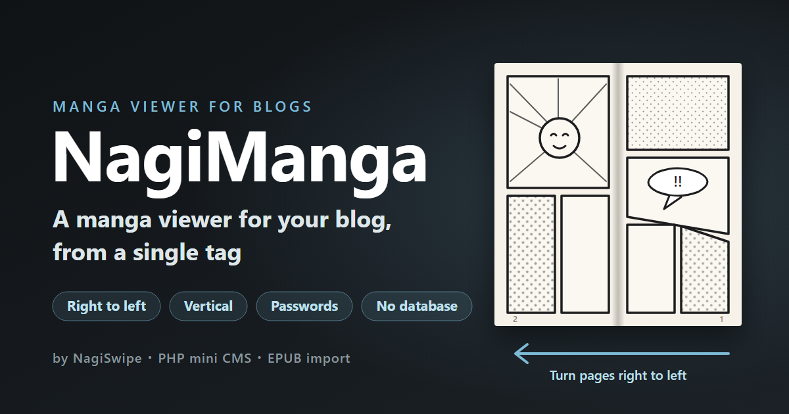
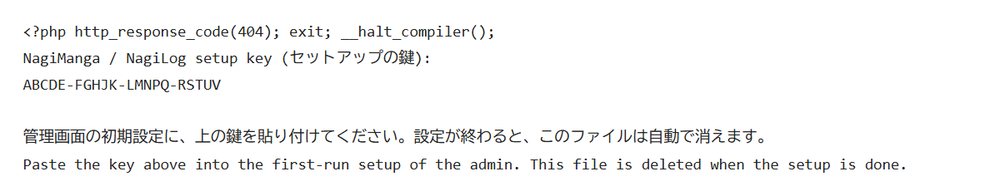
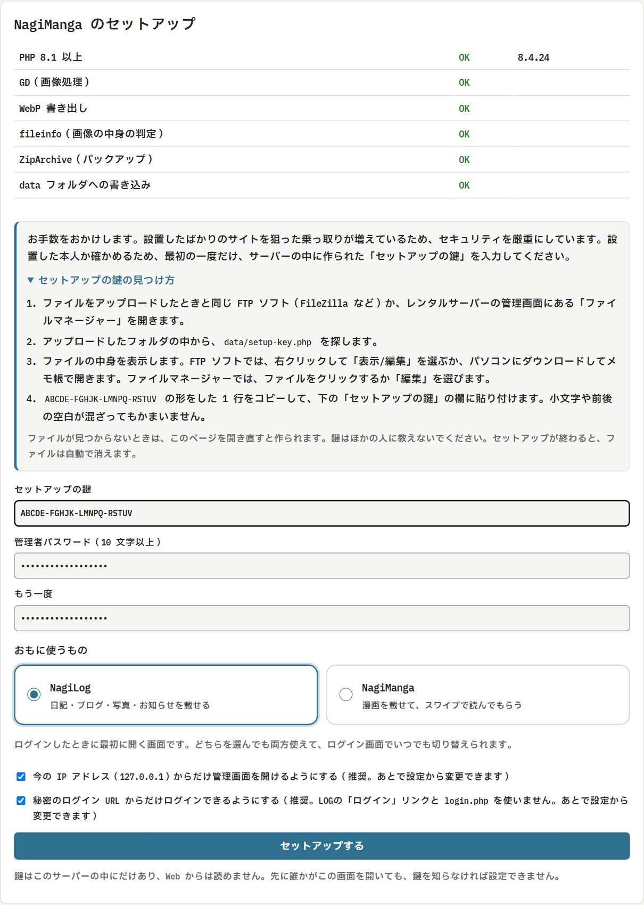
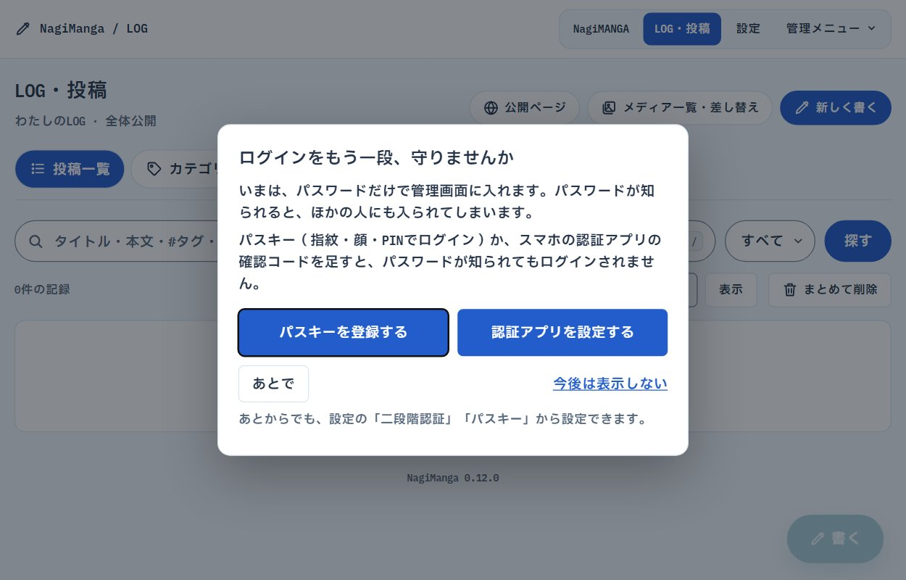

[日本語](README.md) | **English**

# NagiManga (manga viewer)

[](#demo)
[](README-LOG.en.md)
[](https://github.com/Lichiphen/NagiSwipe/releases/latest)
[](https://github.com/Lichiphen/NagiSwipe)
[](https://gitlab.com/lichiphen/nagiswipe)
[](https://nagiswipe.pages.dev/nagimanga.en.html)
[](#two-ways-to-use-it)
[](../LICENSE)

The manga viewer of NagiSeries ([NagiSwipe](../README.en.md#nagiswipe), NagiManga and [NagiLog](README-LOG.en.md)).

Paste **a single tag** into your blog or site, and a manga viewer opens when it is clicked. Works are managed in a small admin panel (PHP) that needs no database.

Since v0.4.0, NagiManga includes NagiLog, a personal log for posting text, pictures and manga.
It has a posting screen for phones, bold text, picture replacement, manga cards, categories, six designs and URLs made from the date and time. Since v0.6.0 it can also post video and audio.
How to use it, its strengths and weaknesses, installation and test results are in the [NagiLog README](README-LOG.en.md).

[](https://lichiphen.com/tool/link/r/NagiManga)
[](https://nagiswipe.pages.dev/nagimanga.en.html)

The admin panel can be shown in Japanese or English (see [Admin panel language](#admin-panel-language)). Some names of buttons and menus below are given in Japanese too, as they appear in the Japanese panel.

<!-- TOC -->
## Contents

- [Demo](#demo)
- [What it does](#what-it-does)
- [Two ways to use it](#two-ways-to-use-it)
- [With the admin panel (PHP)](#with-the-admin-panel-php)
  - [1. Upload](#1-upload)
  - [2. Setup](#2-setup)
  - [3. Checks after installing](#3-checks-after-installing)
  - [4. Make a work and share it](#4-make-a-work-and-share-it)
  - [Posting to Tegalog](#posting-to-tegalog)
- [Features](#features)
  - [Making a work from EPUB](#making-a-work-from-epub)
  - [Light versions (for phones)](#light-versions-for-phones)
  - [Passwords (limited release)](#passwords-limited-release)
  - [Backup](#backup)
  - [Updates (v0.2.0 and later)](#updates-v020-and-later)
  - [Admin panel language](#admin-panel-language)
  - [Embed code](#embed-code)
  - [Work pages (share links, v0.3.0 and later)](#work-pages-share-links-v030-and-later)
  - [Hotlink protection (advanced, v0.3.0 and later)](#hotlink-protection-advanced-v030-and-later)
  - [Access analytics (v0.13.0 and later)](#access-analytics-v0130-and-later)
  - [Plugins (guest mode)](#plugins-guest-mode)
  - [Two-step login (v0.9.1 and later, optional)](#two-step-login-v091-and-later-optional)
  - [Passkeys (v0.10.0 and later, optional)](#passkeys-v0100-and-later-optional)
  - [Troubleshooting](#troubleshooting)
  - [Protecting the data folder](#protecting-the-data-folder)
  - [Tighter IP restriction for the admin panel (optional)](#tighter-ip-restriction-for-the-admin-panel-optional)
- [Without PHP (FTP only)](#without-php-ftp-only)
- [Security approach](#security-approach)
  - [Attack tests](#attack-tests)
- [Development](#development)
- [License](#license)
<!-- /TOC -->

## Demo

**https://notebook.lichiphen.com/nagimanga/demo.html**

- Try the ways of reading (right to left with spreads / left to right / vertical, as paged manga or webtoon)
- There is a password-protected sample (the password is `demo`) and a work imported from a CLIP STUDIO PAINT EPUB
- "ゲストとして管理画面を見る" (view the admin panel as a guest) shows the author's admin panel, read only (nothing can be changed)

**NagiLog demo: https://notebook.lichiphen.com/nagimanga/**

- The log the author actually uses. You can see posts, the phone menu, the mail dialog and the 404 page (inside a black hole)
- Screenshots and explanations are in the [NagiLog README](README-LOG.en.md#screens)

**If you are deciding whether to use it, or want to keep using it for years:** strengths and weaknesses, the technology used and how to take your data out are in [docs/overview.en.md](docs/overview.en.md) (for non-developers).

## What it does

**For readers (the viewer)**

- Right to left (manga) / left to right / vertical (paged manga, each page fitted to the screen, and full-width webtoon)
- Spreads on wide screens (with or without a single cover page). A wide single picture becomes its own page automatically
- Page turning: swipe, tap the screen edges, the ◀ ▶ buttons on the bottom bar, the keyboard, the mouse wheel (vertical reading can also be dragged with the mouse)
- Zoom: pinch, double tap, and on computers the "− 100% ＋" buttons on the top bar, the `+` `-` `0` keys and Ctrl + wheel (move the mouse near the top or bottom edge to show the bars)
- Bookmark (the next time it opens where you stopped), the browser's Back closes it
- Small pictures (light versions) on phones and large ones (normal versions) on computers and when zoomed, chosen automatically

**For creators (the admin panel)**

- Drag and drop pictures, reorder them, issue share tags (the URL is made from the domain you installed on)
- **Make a work directly from a manga EPUB**, such as one from CLIP STUDIO PAINT
- Password-protected releases (readers enter the password when they click)
- Backup and restore (one ZIP)
- A plugin that shows the admin panel to guests, read only (for demos)

It uses no database and no outside libraries (only the standard features of PHP and JavaScript).

## Two ways to use it

| | With the admin panel (PHP) | Without PHP (FTP only) |
|---|---|---|
| For | People who want to manage works in an admin panel (FTP only for the first upload) | People who know their way around folders and URLs |
| Adding pictures | Drag and drop in the admin panel, or from EPUB | Upload with FTP |
| Password protection | Yes | No (anyone who knows a picture's URL can see it) |
| Needs | PHP 8.1 or later (GD, fileinfo, mbstring, ZipArchive); a server where `.htaccess` works (Apache family) is recommended | Any server that can serve static files |

---

## With the admin panel (PHP)

### 1. Upload

Download the latest ZIP (`nagimanga-vX.Y.Z.zip`) with the **Download** button below. Upload what is inside the ZIP (or the contents of `manga/server` in this repository) to any place on your server, under a name such as `nagimanga`.

[](https://lichiphen.com/tool/link/r/NagiManga)

```
nagimanga/
├── read.php          the window for readers (read only)
├── index.php         the public entrance of NagiLog (no file name needed in the URL)
├── log.php           the log itself, and redirects from older URLs
├── .htaccess
├── admin/            the admin panel
├── viewer/           the viewer (NagiManga.js / NagiManga.css)
├── plugins/          where plugins go (empty at first)
├── lib/              the program (not visible from outside)
└── data/             pictures and settings of the works (not visible from outside)
```

- Make the `data` folder writable (on most servers the default 755 is fine).

> [!WARNING]
> **Do not forget to upload `.htaccess`.** Some FTP programs hide files starting with `.` and do not send them (turn on "show hidden files" to see them). There are five: in `nagimanga/`, `admin/`, `lib/`, `data/` and `plugins/`.

### 2. Setup

1. Open `https://your-site/nagimanga/admin/` in a browser. The setup screen appears. **Only now does the server make `data/setup-key.php` (the setup key).** Uploading alone does not make it.
2. Open `data/setup-key.php` with FTP (or the server's file manager). If your FTP app does not show it, refresh the listing. The setup screen also shows how, under "How to find the setup key".
3. Paste the "setup key" written in it (20 characters, like `ABCDE-FGHJK-LMNPQ-RSTUV`) into the field on the screen. Lower case and spaces do not matter.

   

   The file looks like this. The third line, shaped like `XXXXX-XXXXX-XXXXX-XXXXX`, is the key (every site has its own).
4. Choose the administrator password (10 characters or more). It is not made for you.
5. Under "What you will mostly use", pick **NagiLog** (a diary, blog or photos) or **NagiManga** (manga) with the large buttons. It is the screen that opens first after you log in. Either way you can use both, and you can switch on the login page at any time.

- Turn on "allow the admin panel only from the current IP address" whenever you can.



> [!IMPORTANT]
> Only whoever installed the site can read the key, over FTP (it cannot be read from the web). Even if someone else or a bot opens a freshly uploaded site first, they cannot set it up without the key. `data/setup-key.php` is deleted when the setup is done. The "within 30 minutes" limit of v0.11 and earlier is gone.

> [!IMPORTANT]
> When it is done, **the login URL** is shown. **Bookmark it.** Opening the admin panel directly gives "Not Found". Since v0.10.0 the setup ticks "Log in only from the secret login URL" by default. Then `admin/login.php` and the address without `k=` say "Not Found", and the LOG shows no Log in link. Settings → "Common and safety" → "Way in to log in" opens the LOG’s Log in link (`admin/login.php`) again (installs from v0.9 and earlier keep it open). The IP restriction and the limit on attempts apply to both.
>
> The login page lets you choose what opens after logging in (NagiLog or NagiManga) with large buttons; the choice is kept for next time. A browser that has not chosen yet starts with what you picked under "What you will mostly use" in the setup. The login URL with `&p=log` added (shown as "For NagiLog" on the finished screen and under Login URL in the settings) starts with NagiLog chosen.

#### After the first login: two-step login

While neither a passkey nor the two-step login (codes from an authenticator app) is set up, every login shows a dialog that suggests adding one. With either of them, a known password is no longer enough to log in. Set one up here if you can.

- **Register a passkey**: log in with a fingerprint, face or PIN.
- **Set up an authenticator app**: use the 6-digit codes of the iPhone Passwords app, Google Authenticator and the like.
- **Later**: closes it for now. It comes back at the next login.
- **Don’t show this again**: never shows it again. You can still set either up later under Two-step login or Passkeys in the settings.



### 3. Checks after installing

- Log in with the bookmarked URL and make sure the work list **does not show the warning "the data folder can be seen from the internet"** (if it does, `.htaccess` did not arrive or does not work; see "Protecting the data folder" below)
- Opening `https://your-site/nagimanga/data/` gives an error such as "Forbidden", not the contents
- Opening `https://your-site/nagimanga/admin/` as it is gives "Not Found" (proof that setup is done)

### 4. Make a work and share it

1. Make a work in the admin panel and drag and drop the page pictures all at once (they are ordered by file name: 001, 002, …). If you have an EPUB, use "EPUB から作る" (make from EPUB).
2. On the work's page, choose the reading direction and spreads under "共有用のタグ" (share tag), press "コピー" (Copy) and paste it into your blog's HTML.

```html
<a href="#" data-nagimanga="Ab3dE5gH7jK9" data-endpoint="https://example.com/nagimanga/read.php"
   data-direction="rtl" data-view="auto" data-cover="1">Read chapter 1</a>
<script src="https://example.com/nagimanga/viewer/NagiManga.js?v=..." defer></script>
```

| Attribute | Value |
|---|---|
| `data-direction` | `rtl` (right to left) / `ltr` (left to right) / `vertical` (vertical reading) |
| `data-view` | `auto` (spreads on wide screens) / `single` (always one page) |
| `data-cover` | `1` (page 1 alone, spreads start on odd pages) / `0` (spreads from page 1) |
| `data-vertical` | For vertical reading: omitted (paged manga: one page fits the screen height) / `webtoon` (full width, at most 900px) |

- One `<script>` line per page is enough. Put as many links as you like.
- The URL in the tag is made from the address you have the admin panel open at. Enter "設定 → 設置 URL" (Settings → Installation URL) only when you want a different one.
- **To embed on another site (domain)**, register that site's address (for example `https://blog.example.com`) under "設定 → 別のサイトに埋め込む場合" (Settings → Embedding on other sites).

### Posting to Tegalog

Tegalog posts cannot use the HTML tag for blogs. Use the **"共有リンク" (share link)** at the top of the work's page instead.

1. In Tegalog's admin panel, open **[設定] → [システム設定] → 【画像拡大スクリプトの選択】** and choose "**他のスクリプトを使う：URLを指定**".
2. Write NagiManga's URL in the "JavaScriptのURL" field and save. The **"設置用コード" (embed code)** screen of the admin panel has a line you can paste into this field as it is (NagiSwipe and NagiManga together, with cache busters).
   If you use NagiSwipe for zooming pictures, write it **after NagiSwipe's URL and one space** (on one line).

   ```
   https://cdn.jsdelivr.net/gh/Lichiphen/NagiSwipe@83d6ea2/NagiSwipe-main.js https://example.com/nagimanga/viewer/NagiManga.js
   ```

   The part after `@` in the URL (such as `@93db749`) identifies the version of the file. When NagiSwipe is updated, the value in the README changes too. Paste the URL again when you want the new version (until then your site keeps the version you have). After updating NagiManga, paste the new line from "設置用コード" as well.

3. Make manga open **in posts without pictures**: Tegalog does not load the files above on pages of posts without pictures. In [設定] → [ページの表示] → 【投稿本文の表示／URL処理】, under "▼画像URLを画像として埋め込む表示", check **"画像リンクに独自のclass属性値を追加する"**, type `nagimanga` between `class="` and `"`, and save.
4. Open the work in NagiManga's admin panel and press "コピー" next to "共有リンク".
5. Post to Tegalog with the link text (in the example below, "Read chapter 1").

   ```
   [Read chapter 1]https://example.com/nagimanga/read.php?nagimanga=Ab3dE5gH7jK9&dir=rtl
   ```

Pressing "Read chapter 1" in the post opens the manga right there. The reading direction and spread settings are in the URL.

- The URL also works when opened elsewhere, such as in an RSS reader (a page for reading the work opens).
- If Tegalog and NagiManga are on addresses that start differently (the `https://…/` part), register Tegalog's address under "設定 → 別のサイトに埋め込む場合".
- On blogs where you can write HTML, keep using the share tag.

---

## Features

### Making a work from EPUB

A **manga EPUB** exported from CLIP STUDIO PAINT and similar (fixed layout, pages that are only pictures) can be imported with "EPUB から作る" on the work list.

- The page order, reading direction (right to left / left to right) and title come from the EPUB (type a title to replace it).
- If you also choose "小容量版 EPUB（任意）" (light version EPUB, optional), it is assigned as the light versions in the same order. You can add it later with "小容量版 EPUB から割り当てる" on the work's page.
- Pictures are checked and redrawn before saving, as with normal uploads. Blank pages that align spreads are kept.
- EPUBs with DRM (copy protection) and text-only EPUBs cannot be read.
- EPUBs larger than the server's upload limit (`upload_max_filesize` / `post_max_size`) cannot be imported. The limit is shown in the admin panel.

### Light versions (for phones)

Each page can have a smaller "light version". The "ページ" (Pages) part of the work's page has two places to upload.

- **Normal version (computers, zooming)**: the usual page pictures
- **Light version (phones, optional)**: the same pages made smaller. They are assigned in file name order from page 1 (001 → page 1). If the count differs from the number of pages, you are asked to confirm

The viewer reads the light version when it is enough for the size shown and the screen's pixel density, and switches to the normal version on large computer screens or when zoomed (it loads in the background and then swaps, so the page never flashes white). With the device's "data saver" on, light versions come first. Pages without a light version use the normal one.

- Pages with a light version are marked "小" in the list on the work's page
- "小容量版をすべて外す" removes them all (the normal versions stay)
- In password-protected works, light versions also need the key
- They are part of backups and restores

### Passwords (limited release)

Set it under "パスワード" on the work's page. Readers enter the password when they click the link.

- The password is entered **each time the viewer opens** (a correct password hands over a "viewing key" valid only while it is open, thrown away when it closes; the key itself also expires after 2 hours).
- Changing the password invalidates all earlier keys.
- You can see the password you set with "表示" (Show) under "現在のパスワード" on the work's page (it is stored encrypted with the server's secret key; after restoring to another server it cannot be shown, so set it again).
- After 5 wrong tries, the work cannot be tried for 15 minutes (against brute force).

### Backup

"バックアップ" downloads all works as one ZIP. Download it regularly and keep it on your computer or elsewhere.

- It holds the works (page pictures, light versions, order, titles, reading direction, reader passwords). Work IDs stay the same, so tags pasted into blogs keep working.
- It does not hold settings such as the administrator password, login URL and IP restriction, or the secret keys (you set them up again on the new server).
- Restore by uploading the ZIP on the same screen. Everything in the ZIP is checked before it is put back.
- If the server's PHP has no ZipArchive, copy the whole `data/works` folder with FTP.

### Updates (v0.2.0 and later)

When a new version comes out, a notice appears above the work list and above "LOG・投稿" (Log and posts) when you log in ("更新" (Update) in the menu also gets a "新" (new) mark). Press the button on the update screen to update on the spot. The release notes are shown formatted (headings, lists, bold, links).

- It downloads `nagimanga-vX.Y.Z.zip` from the official GitHub release and uses it only when it matches the checksum (SHA-256) GitHub publishes. The contents are checked one by one too.
- From v0.12.0 on it also checks the author's (Lichiphen's) signature (Ed25519, `nagimanga-vX.Y.Z.zip.sig` on the release). The signing key lives only on the author's PC, never on GitHub. If the GitHub account or a release were taken over and the contents swapped, the signature would not match and nothing is updated. On servers whose PHP has no sodium, NagiManga checks it by itself.
- Only program files are replaced. Works and settings (the `data` folder), plugins and `lib/paths.php` stay as they are.
- The files from before the update are kept in `data/update/` (as `.bak` files that cannot run) and can be put back with "元に戻す" (Undo). The last 3 updates are kept.
- It checks at most once every 12 hours. On the update screen you can turn off the check at login or check right away.
- It cannot update by itself when the server cannot reach GitHub (neither PHP's curl nor allow_url_fopen), has no ZipArchive, or cannot write the program files. Then follow "手動で更新する" (update by hand) on the screen (upload everything except the `data` folder over the old files).
- From v0.1.0 to v0.2.0, update by hand (v0.1.0 has no update feature).

### Admin panel language

The admin panel can be shown in Japanese or English: the work list, work pages, Log and posts, categories, fixed pages, the media list, settings, backup, updates, the login screen and the messages shown when saving.

- Choose under "設定 › 共通・安全 › 管理画面の言語" (Settings › Common and security › Admin panel language). It starts as "自動" (Auto): the browser's language if it is supported, Japanese otherwise.
- With “English” chosen, the public pages (the log, work pages, the 404 page, the lock and content warning screens and the text on share cards) are in English too. With “自動” (Auto) the language would differ per browser, so the public pages, which are the same for everyone, stay in Japanese.
- Your own text, such as posts and category names, is not translated. The footer text and the ready-made warnings are shown in English while they are still the defaults.

**Adding a language**: put a JSON file such as `fr.json` in `server/lib/lang/` and it appears in the settings (with a region, such as `zh-CN.json` for Chinese, it works too).

- It holds pairs of `{"Japanese text": "translation"}`. The Japanese text in the program is the key as it is. Write the language name to show in the choices (for example `"Français"`) as `"_name"`. Keys starting with `_` are notes for translators and are not shown.
- Keep placeholders such as `{n}` in the translation. Do not use `'` `"` `&` `<` `>` in translations; use `’` for apostrophes.
- Texts without a translation are shown in Japanese. `python dev/i18n_test.py` checks for missing translations, mismatched placeholders and characters that cannot be used.
- When you add text to the screens, pass it through `nm_t('text')` in PHP or `t('text')` in JS and add the translation to each JSON in `lib/lang/`. For sentences with numbers or names, make the whole sentence the key, as in `nm_t('{n}件の記録', ['n' => $count])`.

### Embed code

"設置用コード" (embed code) in the menu gathers the code for loading the viewer.

- The viewer's URL (the `?v=…` at the end is a **cache buster**: it changes when NagiManga is updated, so readers' browsers do not keep an old viewer)
- A line you can paste as it is into Tegalog's "JavaScriptのURL" field (together with NagiSwipe), and the steps on the Tegalog side
- The `<script>` tag for blogs and HTML

**After updating NagiManga, open this screen again and paste the new values.**

### Work pages (share links, v0.3.0 and later)

The **"共有リンク" (share link)** at the top of the work's page (`read.php?nagimanga=…`) opens a page for reading that work, and the viewer opens by itself.

- Paste this link where manga cannot be embedded, such as note, Ameba Blog, Instagram or X. It shows as a **card with the cover** (OGP). Password-protected works show NagiManga's common picture instead of the cover.
- The page has the cover, the title, a "読む" (Read) button and a **"戻る" (Back) button**. Its destination is set under "設定 → 個別ページ" (empty means automatic: back to the page you came from; when you came from an app such as Instagram and there is nowhere to go back to, the button is not shown).
- "非公開にする" (make private) on a work's page turns its work page off. Viewers embedded in blogs and Tegalog keep working.
- Work IDs are random strings that cannot be guessed. Existing works keep working as they are (no need to make them again).

### Hotlink protection (advanced, v0.3.0 and later)

With "設定 → 上級者向けの設定 → 直リンク防止" (Settings → Advanced → Hotlink protection) on, manga pictures can be read only from pages of "this site", "sites registered for embedding" and "sites on the allow list". It keeps other sites from pasting your pictures and raising your server's traffic. It is off by default.

- `.htaccess` is not rewritten (the check is done inside read.php, so it works on nginx servers too).
- Work pages of share links and the covers for link cards keep working with it on.
- Write the allow list per site (for example `https://note.com`). Browsers do not send the path (such as `/username/`) when loading from other sites, so partial paths cannot be matched.

**The LOG’s pictures, videos and sound (v0.12.0 and later)**: "Use hotlink protection for the LOG’s pictures, videos and sound" in the same place is a switch of its own, apart from manga. With it on, LOG pictures, videos and sound pasted into other sites’ pages or forums are not shown, which saves wasted traffic.

- **Sites set up from v0.12.0 have it on from the start.** Sites set up earlier keep it off after updating; pressing **Turn it on** in the notice on the LOG admin and the work list is all it takes (Not now makes the notice go away).
- The picture of the link card (OGP) shown when the URL is pasted into X, LINE and the like still appears: the services that make cards fetch the picture without a page. Opening the URL directly and RSS readers fetching it work the same way.
- **Share images (OGP) are left out of hotlink protection (v0.12.1 and later).** The shared OGP image and the picture a post shares on its card (its first picture, or the cover of a video or sound file) show on other sites’ pages too, so OGP checkers and blog cards on pages that introduce yours show the picture. Thumbnails and a post’s second and later pictures stay protected.
- Pictures under hotlink protection are kept by the browser only (`Cache-Control: private`, v0.12.1 and later), so a shared cache such as a CDN never hands them on to other sites’ pages. Manga pictures work the same way while manga’s hotlink protection is on.
- The LOG’s own pages, pages that embed the LOG (`embed.php`) and sites on the allow list still show them.
- **For a picture you want other sites to show, such as a link-exchange banner**, tick "Allow other sites to show it" for that picture in the media list and save. Only that picture is left out of hotlink protection. Put the picture in a published post or fixed page (a links page, say).
- For an RSS reader that shows pictures inside the browser, such as Feedly, add that site (for example `https://feedly.com`) to the allow list.

### Access analytics (v0.13.0 and later)

In Settings → SEO and analytics → Access analytics, paste the code an analytics service gives you (Matomo, Google Analytics, Microsoft Clarity, Plausible, Cloudflare Web Analytics and the like), with its `<script>` tags, and save. It goes into the public LOG and the manga pages (`read.php?nagimanga=…`). Save it empty to stop.

- **Code that could harm visitors is not saved.** The code is checked when saved; if something is found, the reason shows as an error toast at the bottom of the screen (no setting is saved). Refused: code that reads cookies, the browser’s stored data or form fields, watches key presses, sends people to another page, rewrites the page (`document.write`, `innerHTML` and so on), makes its own connections, runs text as code (`eval` and so on), obfuscated code, mining and the like. Tags other than `<script>`, attributes such as `onload`, and loading over `http://` are refused too.
- The public pages keep their strict Content-Security-Policy: **only the sites written in the code (and the ones Google Analytics or Clarity use next)** are allowed for scripts, connections and pictures. The pasted inline code is allowed by its hash.
- The `<noscript>` part (counting people without JavaScript) is left out.
- Your own visits to the LOG while logged in are not counted, and the admin pages never get the code.
- If `data/config.php` is edited by hand, every page runs the same check before using the code, and code that does not pass is left out.

On the same tab, Search engine ownership checks takes the meta tag that Google Search Console, Bing Webmaster Tools, Yandex Webmaster, Naver Search Advisor or Baidu show for the HTML tag method, as it is (the code alone works too). It goes into the head of every LOG page. Tags of other services and codes of the wrong form are not saved. Search engines and sitemap is on this tab as well.

### Plugins (guest mode)

PHP plugins placed in `nagimanga/plugins/` add features (only the files placed there are loaded). One plugin is included:

**[`plugins/guest-mode.php`](plugins/guest-mode.php) (guest, read only)**: for showing visitors the inside of the admin panel, as in a demo. Copy this file into `nagimanga/plugins/`, and guests can enter at `admin/index.php?guest`.

- Guests can see works, pages, share tags and the preview, but uploading, reordering, deleting, passwords, light versions, EPUB, backups and changing settings are all refused. The settings screen (login URL, IP, logs) and reader passwords are not shown.
- These limits are enforced by NagiManga itself, not by the plugin. The plugin only decides whether the entrance is open, the passphrase, the guide text and the link shown after leaving.
- Your own login (secret URL + password + IP restriction) is unchanged.
- Deleting the file closes the entrance and locks out guests who are inside.

### Two-step login (v0.9.1 and later, optional)

Logging in can ask for the 6-digit verification code from an authenticator app on your phone as well as the password. Someone who learns the password still cannot log in without your phone. It is off by default.

1. Open Settings → "Common and safety" → "Set up two-step login".
2. Scan the QR code on the screen with an authenticator app. On an iPhone, the built-in Passwords app works (iOS 18 or later; on iOS 17 and earlier, Settings → Passwords). Google Authenticator, Microsoft Authenticator, 1Password and others work too.
   - If the page is open on your phone, "Add to the authenticator app on this phone" opens the app.
   - If scanning does not work, type the key shown (32 letters and digits) by hand.
3. Enter the 6-digit code from the app and the admin password, then press "Confirm and turn on".
4. **The 8 recovery codes are shown only once.** Save them. If you lose your phone, each one works once in place of a verification code.

- A verification code works only once (the same code cannot log in again). A phone clock that is about 30 seconds off is accepted.
- The code box takes half-width digits only: full-width digits (a Japanese keyboard) become half-width, and letters, signs and spaces in between are dropped. On a PC with the Japanese input method on, nothing stays unconverted: only half-width digits show.
- Wrong codes count like wrong passwords (by default, locked for 15 minutes after 5).
- Turning it on or off logs out the other devices.
- The key is kept encrypted in `data/config.php`.
- The app lists it as “NagiSeries NagiLog” with the site’s domain (for example `example.com`) as the account name. The name does not change the codes, so codes registered before keep working. Apps that read an image field (`image=`) also get the LOG’s favicon (NagiManga’s icon if none is set). Apps such as Authy look up a logo by the name and may show an unrelated one; pick the generic logo (a key) then.

> [!NOTE]
> The QR code is made inside this program (`lib/qrcode.php`); the key is never sent to another service. QR Code is a registered trademark of DENSO WAVE INCORPORATED.

### Passkeys (v0.10.0 and later, optional)

Log in without the password, with a passkey saved in Proton Pass, the iPhone Passwords app (iCloud Keychain), Google Password Manager, 1Password, Windows Hello and others.

1. Open Settings → "Common and safety" → "Register a passkey".
2. Enter a name (e.g. iPhone, Proton Pass) and the admin password, then press "Register a passkey"; the browser asks where to save it.
3. From then on, press **"Log in with a passkey"** on the login screen and confirm with your fingerprint, face or PIN.

- **Passkeys work only at an HTTPS address** (`https://…`; `http://localhost` for testing is the exception).
- A passkey is **bound to the domain it was registered on**. Register again after moving to another domain.
- A passkey proves both that you have the device and who you are, so logging in with one asks for **neither the password nor the two-step code**. Logging in with the password (and the code) still works as before.
- Up to 10 passkeys. Deleting one needs the admin password.
- Failures count like wrong passwords (by default, locked for 15 minutes after 5).
- Only the public keys are kept (`data/config.php`); the private keys never leave the passkey provider.
- No outside library or service: PHP’s openssl checks them (ES256 and RS256).

### Troubleshooting

| Problem | What to do |
|---|---|
| You do not know the setup key | Open `data/setup-key.php` with FTP (if it is not there, opening the admin panel again makes it) |
| You forgot the login URL (with the secret login URL only, there is no other way in) | Open `data/config.php` with FTP and open `admin/index.php?k=` followed by the value of `login_key` |
| Your IP address changed and you are locked out | With FTP, set `allowed_ips` in `data/config.php` to `array ( )` (and the line in `admin/.htaccess` if you wrote an IP restriction there) |
| Too many wrong logins | Wait for the lock time you set (15 minutes by default); the login screen says "Not Found" meanwhile. A browser you logged in with before, or a passkey, still gets in. In a hurry, delete the contents of `data/ratelimit` with FTP |
| "There have been many failed logins…" and the password is not taken | Other people’s failures across the site are many. A browser you logged in with before, a passkey or an allowed IP address still gets in. Wait up to 1 hour, or delete the contents of `data/ratelimit` with FTP |
| The update stops with "no signature" or "signature does not match" | The author’s signature could not be checked, so it stopped to be safe (nothing changed). Wait for the GitHub release to be fixed, or upload the ZIP of the official release over the files by hand |
| You lost the phone for two-step login | Enter one of the recovery codes you saved in the code field. Without them, open `data/config.php` with FTP and delete the entry that starts with `'totp' =>` (two-step login turns off) |
| A passkey does not work or is lost | Log in with the password (and the code), then delete it or register again in Settings → Passkeys. To remove all, open `data/config.php` with FTP and delete the entry that starts with `'passkeys' =>` |
| The admin panel says the data folder can be seen from the internet | See "Protecting the data folder" below |
| An EPUB cannot be imported | Check that it has no DRM, is not text only, and is within the upload limit (shown in the admin panel) |

### Protecting the data folder

The `data` folder is hidden from outside with `.htaccess`. On servers where `.htaccess` does not work (such as nginx), do one of these:

1. **Recommended:** move the `data` folder outside the public folder (for example `/home/you/nagimanga-data`) and write its place in a new `lib/paths.php`

   ```php
   <?php return '/home/you/nagimanga-data';
   ```

2. On nginx, set `location ~ /nagimanga/(data|lib|plugins)/ { deny all; }`

> [!CAUTION]
> The storage folder names are made from the secret key, but that is not encryption. If `.htaccess` does not work and the real path of a picture becomes known, the picture can be opened directly. Move the storage outside the public folder or deny access in the server settings.

- The settings files are PHP, so their contents are not shown.
- Work folder names are made from the secret key and cannot be guessed from public IDs.
- Each folder has an empty `index.html`, so folder listings are not shown.

The log's internal records, the security log (`data/logs/security.log.php`), the setup key (`data/setup-key.php`) and the record of the update check (`data/update/check.php`) are PHP files that give 404 when opened directly. Protecting static pictures needs the storage place or server settings above.

**What stays protected when `.htaccess` does not work (v0.12.0 and later)**

| | Without a working `.htaccess` | To protect it |
|---|---|---|
| Settings, passwords, secret keys, logs, the setup key, LOG posts | Cannot be read (PHP files that give 404) | ― |
| Pictures and videos of works and the LOG | The storage folder names cannot be guessed, but once a real URL is known it opens without the reader password or hotlink protection | Move the storage outside the public folder, or deny it in the server settings (1 or 2 above) |
| The LOG’s clean URLs (`/20261027123456`, `/privacy`), the 404 page, cache settings | Not available (the LOG switches to `?id=` and `?pg=` URLs by itself, so posts still open) | Upload `.htaccess` on an Apache-type server |

On Apache-type servers (most rental hosting), uploading `.htaccess` turns on everything in this table.

### Tighter IP restriction for the admin panel (optional)

Remove the `#` from the IP restriction line in `admin/.htaccess` and write your IP address. It doubles the IP restriction set in the admin panel.

---

## Without PHP (FTP only)

1. Put `server/viewer/NagiManga.js` and `NagiManga.css` in the same folder.
2. Open [`tools/manifest-maker.html`](tools/manifest-maker.html) in a browser, choose the page pictures and make `manifest.json` (the pictures are not sent anywhere).
3. Put `manifest.json` and the pictures on the server, and paste this tag into the page.

```html
<a href="#" data-nagimanga-manifest="/manga/ep1/manifest.json" data-direction="rtl">Read chapter 1</a>
<script src="/manga/NagiManga.js" defer></script>
```

Picture locations in `manifest.json` are relative to the place of `manifest.json` (or full URLs).

```json
{ "title": "Chapter 1", "direction": "rtl", "pages": [ { "src": "001.jpg", "w": 1200, "h": 1700 } ] }
```

---

## Security approach

- **The public side is read only.** All `read.php` can do is "list a work's pages", "check a password" and "return a picture". Every odd request gets the same "Not Found", telling nothing about what exists.
- **Five locks on the admin panel.** IP restriction → secret login URL → password (locked after a number of failures, for a time, both set in the settings: 5 and 15 minutes by default; at most 40 per hour overall; when turned on, then a code from an authenticator app; or, once registered, a passkey instead) → a session bound to the browser (30 days from the last login, up to 1 year in the settings) → CSRF protection on every action.
- **Other people's failures do not shut the owner out.** A browser that has logged in gets the owner's mark (a cookie signed with the server's secret key). Marked browsers, passkeys and allowed IP addresses still get in after the overall limit (40 per hour) is reached. A marked browser is counted by browser, not by IP, and loses the mark's privilege after 5 failures. Changing the password voids every mark.
- **IPv6 is counted by range.** Failures from IPv6 are counted per /64 (the range one line gets). A work's reader password and a locked post check answers one at a time, 20 seconds apart (v0.12.1 and later; earlier versions stopped them for the hour), after 60 wrong answers per hour for that work or post together. A new reader is held for a moment instead of being shut out for the hour (when it is busy, they are asked to try again in a minute; readers who already opened it keep reading).
- **Uploaded pictures are always redrawn.** Whether a file is a picture is judged from its contents, not its name; it is read with GD and written to a new file. Programs hidden in pictures and data such as the shooting location do not survive. File names are given anew. SVG is not accepted for manga pages. EPUB and backup ZIPs are also checked item by item before use.
- **Programs do not run in the picture folders.** `data` cannot be seen from outside, and only `.webp` / `.jpg` are stored.
- **Error details are not shown on screen.** So that server paths and the like do not leak. Records go to `data/logs/security.log.php`, which can be read on the settings page of the admin panel. Being a PHP file, it cannot be read from the web even on servers that ignore `.htaccess` (nginx and others).

### Attack tests

[`dev/attack_test.py`](dev/attack_test.py) runs the normal checks and reproduced attacks together. With Python 3 and PHP 8.1 or later (GD, fileinfo, zip, mbstring, sodium or openssl) nothing else needs installing. The log is checked with [`dev/log_test.py`](dev/log_test.py).

```bash
python dev/attack_test.py
```

<details><summary>What the attack tests check</summary>

What it covers: PHP disguised as a picture, uploads of `.htaccess` / SVG / HTML, pixel bombs, escaping folders with `../`, ZIP slip and ZIP bombs, malicious EPUBs (XXE, DRM, paths pointing outside the book), CSRF, XSS, forged, tampered, expired and reused viewing keys, brute force (including forged `X-Forwarded-For`), getting around the IP restriction, the setup key, unsigned or swapped update packages, odd Host headers, changes by guests (19 kinds) and information leaks on servers where `.htaccess` does not work. The results are written to `dev/results/attack-report.md`.

[`dev/hardening_test.py`](dev/hardening_test.py) tries attacks from many IP addresses (made with `X-Forwarded-For`): that the owner is not shut out by the site-wide limit, that IPv6 counts per /64, the limit per work, guessing the password from a logged-in screen, and the log without `.htaccess`.

</details>

## Development

```bash
dev\serve.cmd              # http://127.0.0.1:5190 (data in dev/data)
python dev/seed.py         # registers sample works and makes dev/results/demo.html
python dev/build_release.py  # the release ZIP (dev/results/nagimanga-vX.Y.Z.zip)
python dev/i18n_test.py    # checks the admin panel translations (server/lib/lang/*.json) for gaps
python dev/hardening_test.py  # checks lockouts, IPv6, the limit per work and the log
python dev/release_sign.py keygen  # makes the release signing keys (once; they stay outside the repository)
python ../site/build.py    # rebuilds the documentation site from the READMEs
```

The [documentation site](https://nagiswipe.pages.dev/index.en.html) is built from README.md, manga/README.md, manga/README-LOG.md and manga/docs/overview.md at the root of the repository, and their English versions (`.en.md`). The text of the top page is `site/top.html` and `site/top.en.html`, the look `site/site.css`. After changing a README, rebuild the pages and commit them together. The site files are not part of the release ZIP or GitHub's source code ZIP.

The jsDelivr URLs in the README are pinned to the commit that last changed the file (for example `…/NagiSwipe@93db749/NagiSwipe-main.js`). A commit URL never changes its contents, and the URL changes whenever the file does, so browsers and jsDelivr never keep an old file. Install the hook with `cp scripts/post-commit.sh .git/hooks/post-commit`, and after a commit that changes NagiSwipe-main.js / .css the README URLs are rewritten automatically and the pages of the [documentation site](https://nagiswipe.pages.dev/) (`python site/build.py`) are rebuilt and committed (by hand: `python scripts/cachebust.py README.md README.en.md manga/README.md manga/README.en.md manga/README-LOG.md manga/README-LOG.en.md site/top.html site/top.en.html`, then `python site/build.py`).

To release, raise `NM_VERSION` in `lib/bootstrap.php` and `VERSION` in `viewer/NagiManga.js` to the same number, make the ZIP with `dev/build_release.py` and attach it to a GitHub release. Installed copies of NagiManga look at the release's `nagimanga-vX.Y.Z.zip` (holding a `nagimanga/` folder) to announce updates.

Version numbers: small fixes and additions raise the last number (0.5.0 → 0.5.1 → … → 0.5.99). Only big updates raise the middle number (0.6.0). Installed copies announce an update only when the number is higher than theirs, so a number lower than one already released is never used.

## License

[MIT License](../LICENSE) (c) 2026 Lichiphen

QR Code is a registered trademark of DENSO WAVE INCORPORATED.
